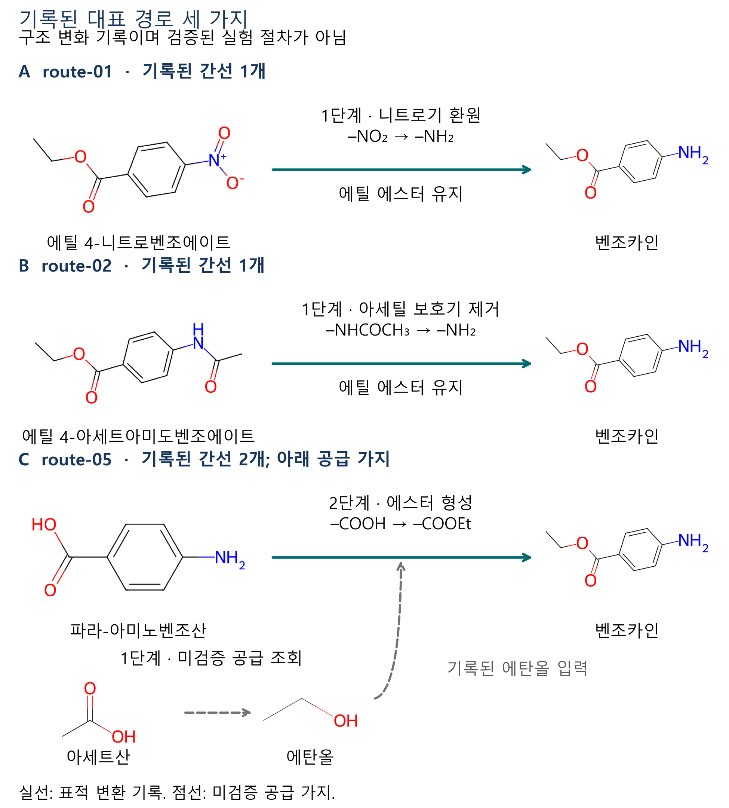
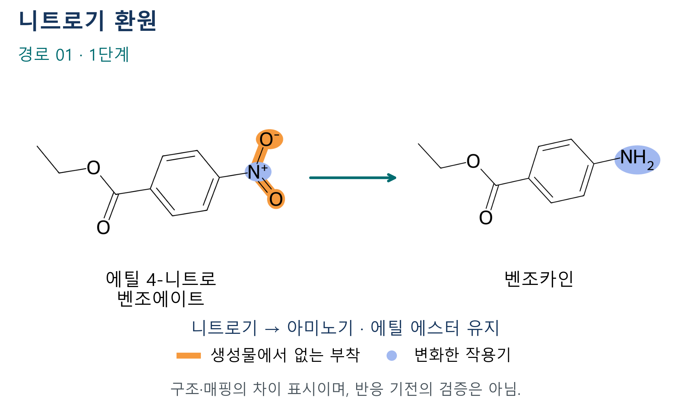
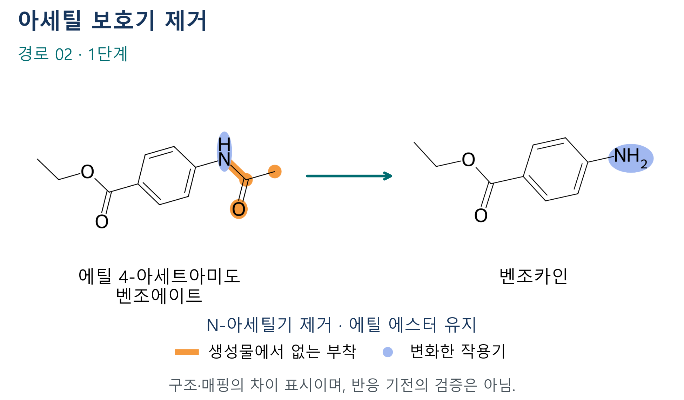
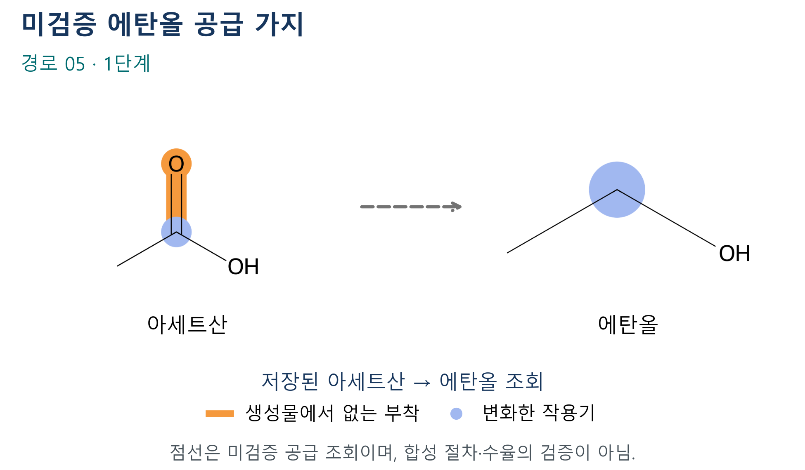
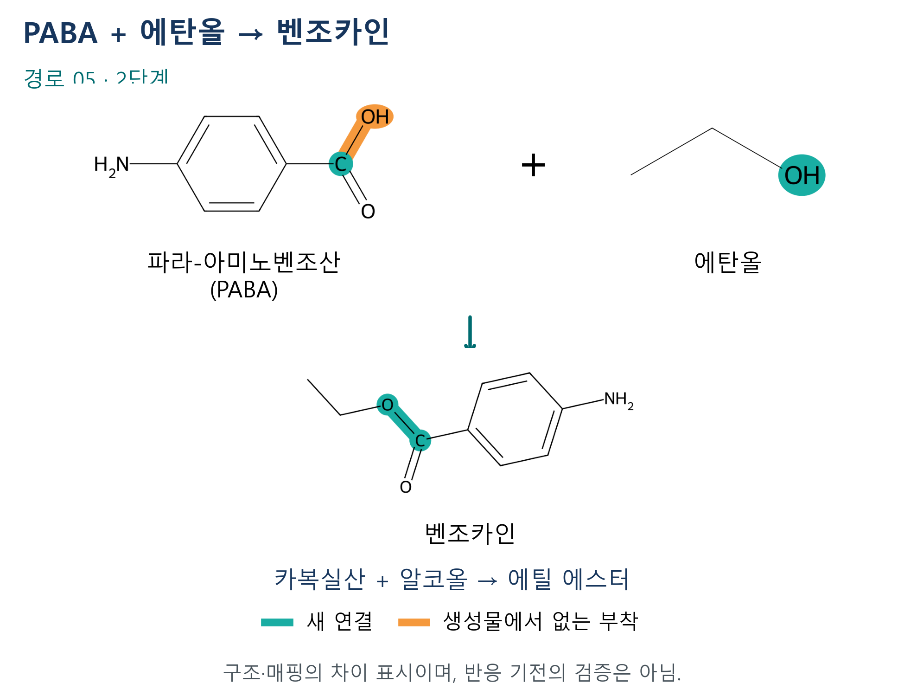
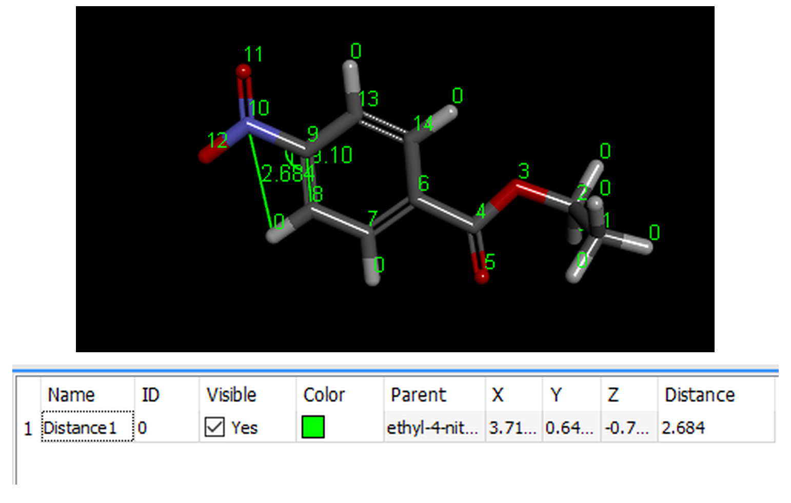
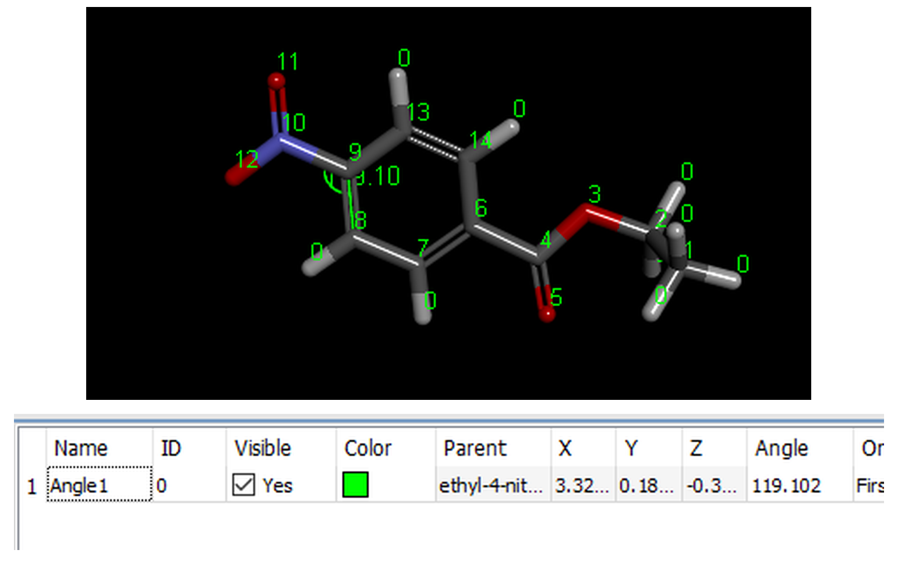
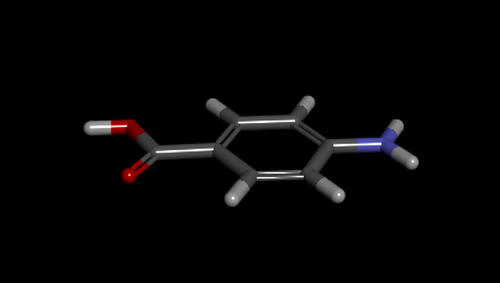

<!-- COVERAGE_MAP_BEGIN
[
{"old_block_id":"OLD-001","new_section":"1. 대상 물질과 검토 범위","action":"retain","correction_evidence":"벤조카인 구조·선정 근거 보존"},
{"old_block_id":"OLD-002","new_section":"1. 대상 물질과 검토 범위","action":"retain","correction_evidence":"역합성 탐색 개요 보존"},
{"old_block_id":"OLD-003","new_section":"2. 탐색 범위와 경로 선정","action":"retain","correction_evidence":"실행 개요 보존"},
{"old_block_id":"OLD-004","new_section":"2. 탐색 범위와 경로 선정","action":"retain","correction_evidence":"12개 경로·선정 기준 보존"},
{"old_block_id":"OLD-005","new_section":"2. 탐색 범위와 경로 선정","action":"retain","correction_evidence":"대표 경로 구성 보존"},
{"old_block_id":"OLD-006","new_section":"2. 탐색 범위와 경로 선정","action":"retain","correction_evidence":"경로 요약 표 보존"},
{"old_block_id":"OLD-007","new_section":"2. 탐색 범위와 경로 선정","action":"retain","correction_evidence":"Parrot 후보·예측 수율 표 보존"},
{"old_block_id":"OLD-008","new_section":"3. 경로별 구조 변화와 조건·수율","action":"retain","correction_evidence":"구조 변화 서술 보존"},
{"old_block_id":"OLD-009","new_section":"3. 경로별 구조 변화와 조건·수율","action":"retain","correction_evidence":"route-01 구조·템플릿·조건·수율 보존"},
{"old_block_id":"OLD-010","new_section":"3. 경로별 구조 변화와 조건·수율","action":"retain","correction_evidence":"route-02 구조·템플릿·조건·수율 보존"},
{"old_block_id":"OLD-011","new_section":"3. 경로별 구조 변화와 조건·수율","action":"retain","correction_evidence":"route-05/step-01 구조·템플릿·조건·수율 보존"},
{"old_block_id":"OLD-012","new_section":"3. 경로별 구조 변화와 조건·수율","action":"retain","correction_evidence":"route-05/step-02 구조·템플릿·조건·수율 보존"},
{"old_block_id":"OLD-013","new_section":"3. 경로별 구조 변화와 조건·수율","action":"retain","correction_evidence":"강의 비교 서술 보존"},
{"old_block_id":"OLD-014","new_section":"3. 경로별 구조 변화와 조건·수율","action":"retain","correction_evidence":"강의 vs AI 비교 표 보존"},
{"old_block_id":"OLD-015","new_section":"3. 경로별 구조 변화와 조건·수율","action":"retain","correction_evidence":"표기 원칙 표 보존"},
{"old_block_id":"OLD-016","new_section":"4. 모델별 입력·출력·한계","action":"retain","correction_evidence":"AiZynthFinder 서술 보존"},
{"old_block_id":"OLD-017","new_section":"4. 모델별 입력·출력·한계","action":"retain","correction_evidence":"Parrot 서술 보존"},
{"old_block_id":"OLD-018","new_section":"4. 모델별 입력·출력·한계","action":"retain","correction_evidence":"rxn_yields 서술 보존"},
{"old_block_id":"OLD-019","new_section":"4. 모델별 입력·출력·한계","action":"correct","correction_evidence":"route-05/step-01을 실제 ethanol 공급 수율로 읽지 않도록 정정; route05-step01-provenance-review.md; four_step_yield_mapping.csv"},
{"old_block_id":"OLD-020","new_section":"4. 모델별 입력·출력·한계","action":"retain","correction_evidence":"모델 간 관계 정리 보존"},
{"old_block_id":"OLD-021","new_section":"5. 추가 분석 개요","action":"retain","correction_evidence":"추가 분석 도입 보존"},
{"old_block_id":"OLD-022","new_section":"5.1 MOPAC PM7 계산","action":"retain","correction_evidence":"MOPAC 서술 보존"},
{"old_block_id":"OLD-023","new_section":"5.1 MOPAC PM7 계산","action":"retain","correction_evidence":"MOPAC 생성열·결합 거리 보존"},
{"old_block_id":"OLD-024","new_section":"5.1 MOPAC PM7 계산","action":"retain","correction_evidence":"MOPAC 해석·한계 보존"},
{"old_block_id":"OLD-025","new_section":"외부 실행 기록","action":"reorganize","correction_evidence":"혼합 블록의 과학 내용은 본문으로, 기술 기록은 외부로 분리"},
{"old_block_id":"OLD-026","new_section":"5.2 EPI Suite","action":"retain","correction_evidence":"EPI 도구·실행 상태 보존"},
{"old_block_id":"OLD-027","new_section":"5.2 EPI Suite","action":"retain","correction_evidence":"EPI 추정값·DB 기록 표 보존"},
{"old_block_id":"OLD-028","new_section":"5.2 EPI Suite","action":"retain","correction_evidence":"EPI 구조·지원 검토 보존"},
{"old_block_id":"OLD-029","new_section":"5.2 EPI Suite","action":"retain","correction_evidence":"EPI 반응 조건 한계 보존"},
{"old_block_id":"OLD-030","new_section":"5.2 EPI Suite","action":"retain","correction_evidence":"EPI 재현·파일 보존"},
{"old_block_id":"OLD-031","new_section":"5.3 Discovery Studio Visualizer","action":"retain","correction_evidence":"Visualizer 범위 서술 보존"},
{"old_block_id":"OLD-032","new_section":"5.3 Discovery Studio Visualizer","action":"retain","correction_evidence":"실제 측정 표 보존"},
{"old_block_id":"OLD-033","new_section":"5.3 Discovery Studio Visualizer","action":"retain","correction_evidence":"해석 보존"},
{"old_block_id":"OLD-034","new_section":"5.3 Discovery Studio Visualizer","action":"retain","correction_evidence":"완료·미완료 기록 보존"},
{"old_block_id":"OLD-035","new_section":"5.4 하네스 비교","action":"retain","correction_evidence":"하네스 비교 도입 보존"},
{"old_block_id":"OLD-036","new_section":"5.4 하네스 비교","action":"retain","correction_evidence":"실행 요약 보존"},
{"old_block_id":"OLD-037","new_section":"5.4 하네스 비교","action":"retain","correction_evidence":"입력·생성 설정 보존"},
{"old_block_id":"OLD-038","new_section":"5.4 하네스 비교","action":"retain","correction_evidence":"내용 비교 보존"},
{"old_block_id":"OLD-039","new_section":"5.4 하네스 비교","action":"retain","correction_evidence":"확인된 불일치 보존"},
{"old_block_id":"OLD-040","new_section":"5.4 하네스 비교","action":"correct","correction_evidence":"route-05/step-01 수율 의미를 실제 단계 수율로 쓰지 않도록 정정"},
{"old_block_id":"OLD-041","new_section":"5.4 하네스 비교","action":"retain","correction_evidence":"비용 한도·원장 서술 보존(외부 기록 경계 준수)"},
{"old_block_id":"OLD-042","new_section":"6. 문헌 대조","action":"retain","correction_evidence":"문헌 대조 도입 보존"},
{"old_block_id":"OLD-043","new_section":"6. 문헌 대조","action":"retain","correction_evidence":"route-01 직접 문헌 보존"},
{"old_block_id":"OLD-044","new_section":"6. 문헌 대조","action":"retain","correction_evidence":"Parrot 조건 대조 보존"},
{"old_block_id":"OLD-045","new_section":"외부 실행 기록","action":"reorganize","correction_evidence":"혼합 블록의 과학 내용은 본문으로, 기술 기록은 외부로 분리"},
{"old_block_id":"OLD-046","new_section":"6. 문헌 대조","action":"retain","correction_evidence":"Yield-BERT 대조 보존"},
{"old_block_id":"OLD-047","new_section":"7. 조건부 검토 결론","action":"retain","correction_evidence":"확인된 결과 보존"},
{"old_block_id":"OLD-048","new_section":"7. 조건부 검토 결론","action":"retain","correction_evidence":"우선 검토 경로 보존"},
{"old_block_id":"OLD-049","new_section":"7. 조건부 검토 결론","action":"correct","correction_evidence":"route-05/step-01을 검증된 순차 단계로 읽지 않도록 정정"},
{"old_block_id":"OLD-050","new_section":"7. 조건부 검토 결론","action":"retain","correction_evidence":"추가 확인 사항 보존"},
{"old_block_id":"OLD-051","new_section":"8. 재현 방법과 출처","action":"retain","correction_evidence":"실행 재현 개요 보존"},
{"old_block_id":"OLD-052","new_section":"8. 재현 방법과 출처","action":"retain","correction_evidence":"재현 주의점 보존"},
{"old_block_id":"OLD-053","new_section":"외부 실행 기록","action":"reorganize","correction_evidence":"혼합 블록의 과학 내용은 본문으로, 기술 기록은 외부로 분리"},
{"old_block_id":"OLD-054","new_section":"8. 재현 방법과 출처","action":"retain","correction_evidence":"출처 목록 보존"},
{"old_block_id":"OLD-055","new_section":"8. 재현 방법과 출처","action":"retain","correction_evidence":"프로젝트 증거 파일 보존"},
{"old_block_id":"OLD-056","new_section":"부록: 미해결 사항과 기록 보존 원칙","action":"retain","correction_evidence":"미해결 사항 보존"},
{"old_block_id":"OLD-057","new_section":"부록: 미해결 사항과 기록 보존 원칙","action":"retain","correction_evidence":"기록 보존 원칙 보존"},
{"old_block_id":"OLD-058","new_section":"부록: 미해결 사항과 기록 보존 원칙","action":"retain","correction_evidence":"과거 상태 상충 보존"},
{"old_block_id":"OLD-059","new_section":"부록: 미해결 사항과 기록 보존 원칙","action":"retain","correction_evidence":"구성 파일 해시 차이 보존"},
{"old_block_id":"OLD-060","new_section":"부록: 미해결 사항과 기록 보존 원칙","action":"retain","correction_evidence":"보고서 작성 원칙 보존"},
{"old_block_id":"OLD-061","new_section":"외부 실행 기록","action":"reorganize","correction_evidence":"기술 기록 분리"},
{"old_block_id":"OLD-062","new_section":"외부 실행 기록","action":"reorganize","correction_evidence":"기술 기록 분리"},
{"old_block_id":"OLD-063","new_section":"외부 실행 기록","action":"reorganize","correction_evidence":"기술 기록 분리"},
{"old_block_id":"OLD-064","new_section":"외부 실행 기록","action":"reorganize","correction_evidence":"기술 기록 분리"},
{"old_block_id":"OLD-065","new_section":"외부 실행 기록","action":"reorganize","correction_evidence":"기술 기록 분리"},
{"old_block_id":"OLD-066","new_section":"외부 실행 기록","action":"correct","correction_evidence":"route-05/step-01 수율 의미 정정 반영"},
{"old_block_id":"OLD-067","new_section":"외부 실행 기록","action":"reorganize","correction_evidence":"기술 기록 분리"},
{"old_block_id":"OLD-068","new_section":"외부 실행 기록","action":"reorganize","correction_evidence":"기술 기록 분리"},
{"old_block_id":"OLD-069","new_section":"외부 실행 기록","action":"reorganize","correction_evidence":"기술 기록 분리"},
{"old_block_id":"OLD-070","new_section":"외부 실행 기록","action":"reorganize","correction_evidence":"기술 기록 분리"},
{"old_block_id":"OLD-071","new_section":"외부 실행 기록","action":"reorganize","correction_evidence":"기술 기록 분리"},
{"old_block_id":"OLD-072","new_section":"외부 실행 기록","action":"reorganize","correction_evidence":"기술 기록 분리"},
{"old_block_id":"OLD-073","new_section":"외부 실행 기록","action":"reorganize","correction_evidence":"기술 기록 분리"},
{"old_block_id":"OLD-074","new_section":"외부 실행 기록","action":"reorganize","correction_evidence":"기술 기록 분리"},
{"old_block_id":"OLD-075","new_section":"외부 실행 기록","action":"reorganize","correction_evidence":"기술 기록 분리"},
{"old_block_id":"OLD-076","new_section":"외부 실행 기록","action":"reorganize","correction_evidence":"기술 기록 분리"},
{"old_block_id":"OLD-077","new_section":"외부 실행 기록","action":"reorganize","correction_evidence":"기술 기록 분리"},
{"old_block_id":"OLD-078","new_section":"외부 실행 기록","action":"reorganize","correction_evidence":"기술 기록 분리"},
{"old_block_id":"OLD-079","new_section":"외부 실행 기록","action":"reorganize","correction_evidence":"기술 기록 분리"},
{"old_block_id":"OLD-080","new_section":"외부 실행 기록","action":"reorganize","correction_evidence":"기술 기록 분리"},
{"old_block_id":"OLD-081","new_section":"외부 실행 기록","action":"reorganize","correction_evidence":"기술 기록 분리"},
{"old_block_id":"OLD-082","new_section":"외부 실행 기록","action":"reorganize","correction_evidence":"기술 기록 분리"},
{"old_block_id":"OLD-083","new_section":"외부 실행 기록","action":"reorganize","correction_evidence":"기술 기록 분리"},
{"old_block_id":"OLD-084","new_section":"외부 실행 기록","action":"reorganize","correction_evidence":"기술 기록 분리"},
{"old_block_id":"OLD-085","new_section":"외부 실행 기록","action":"reorganize","correction_evidence":"기술 기록 분리"},
{"old_block_id":"OLD-086","new_section":"외부 실행 기록","action":"reorganize","correction_evidence":"기술 기록 분리"},
{"old_block_id":"OLD-087","new_section":"외부 실행 기록","action":"reorganize","correction_evidence":"기술 기록 분리"},
{"old_block_id":"OLD-088","new_section":"외부 실행 기록","action":"reorganize","correction_evidence":"기술 기록 분리"},
{"old_block_id":"OLD-089","new_section":"외부 실행 기록","action":"reorganize","correction_evidence":"기술 기록 분리"},
{"old_block_id":"OLD-090","new_section":"외부 실행 기록","action":"reorganize","correction_evidence":"기술 기록 분리"},
{"old_block_id":"OLD-091","new_section":"외부 실행 기록","action":"reorganize","correction_evidence":"기술 기록 분리"},
{"old_block_id":"OLD-092","new_section":"외부 실행 기록","action":"reorganize","correction_evidence":"기술 기록 분리"},
{"old_block_id":"OLD-093","new_section":"외부 실행 기록","action":"reorganize","correction_evidence":"기술 기록 분리"},
{"old_block_id":"OLD-094","new_section":"외부 실행 기록","action":"reorganize","correction_evidence":"기술 기록 분리"},
{"old_block_id":"OLD-095","new_section":"외부 실행 기록","action":"reorganize","correction_evidence":"기술 기록 분리"},
{"old_block_id":"OLD-096","new_section":"외부 실행 기록","action":"reorganize","correction_evidence":"기술 기록 분리"},
{"old_block_id":"OLD-097","new_section":"외부 실행 기록","action":"reorganize","correction_evidence":"기술 기록 분리"},
{"old_block_id":"OLD-098","new_section":"외부 실행 기록","action":"reorganize","correction_evidence":"기술 기록 분리"},
{"old_block_id":"OLD-099","new_section":"외부 실행 기록","action":"reorganize","correction_evidence":"기술 기록 분리"},
{"old_block_id":"OLD-100","new_section":"외부 실행 기록","action":"reorganize","correction_evidence":"기술 기록 분리"},
{"old_block_id":"OLD-101","new_section":"외부 실행 기록","action":"reorganize","correction_evidence":"기술 기록 분리"},
{"old_block_id":"OLD-102","new_section":"외부 실행 기록","action":"reorganize","correction_evidence":"기술 기록 분리"},
{"old_block_id":"OLD-103","new_section":"외부 실행 기록","action":"reorganize","correction_evidence":"기술 기록 분리"},
{"old_block_id":"OLD-104","new_section":"외부 실행 기록","action":"reorganize","correction_evidence":"기술 기록 분리"},
{"old_block_id":"OLD-105","new_section":"외부 실행 기록","action":"reorganize","correction_evidence":"기술 기록 분리"},
{"old_block_id":"OLD-106","new_section":"외부 실행 기록","action":"reorganize","correction_evidence":"기술 기록 분리"},
{"old_block_id":"OLD-107","new_section":"외부 실행 기록","action":"reorganize","correction_evidence":"기술 기록 분리"},
{"old_block_id":"OLD-108","new_section":"외부 실행 기록","action":"reorganize","correction_evidence":"기술 기록 분리"},
{"old_block_id":"OLD-109","new_section":"외부 실행 기록","action":"reorganize","correction_evidence":"기술 기록 분리"},
{"old_block_id":"OLD-110","new_section":"외부 실행 기록","action":"reorganize","correction_evidence":"기술 기록 분리"},
{"old_block_id":"OLD-111","new_section":"외부 실행 기록","action":"reorganize","correction_evidence":"기술 기록 분리"},
{"old_block_id":"OLD-112","new_section":"외부 실행 기록","action":"reorganize","correction_evidence":"기술 기록 분리"},
{"old_block_id":"OLD-113","new_section":"외부 실행 기록","action":"reorganize","correction_evidence":"기술 기록 분리"},
{"old_block_id":"OLD-114","new_section":"외부 실행 기록","action":"reorganize","correction_evidence":"기술 기록 분리"},
{"old_block_id":"OLD-115","new_section":"외부 실행 기록","action":"reorganize","correction_evidence":"기술 기록 분리"},
{"old_block_id":"OLD-116","new_section":"외부 실행 기록","action":"reorganize","correction_evidence":"기술 기록 분리"},
{"old_block_id":"OLD-117","new_section":"외부 실행 기록","action":"reorganize","correction_evidence":"기술 기록 분리"},
{"old_block_id":"OLD-118","new_section":"외부 실행 기록","action":"reorganize","correction_evidence":"기술 기록 분리"},
{"old_block_id":"OLD-119","new_section":"외부 실행 기록","action":"reorganize","correction_evidence":"기술 기록 분리"},
{"old_block_id":"OLD-120","new_section":"외부 실행 기록","action":"reorganize","correction_evidence":"기술 기록 분리"},
{"old_block_id":"OLD-121","new_section":"외부 실행 기록","action":"reorganize","correction_evidence":"기술 기록 분리"},
{"old_block_id":"OLD-122","new_section":"외부 실행 기록","action":"reorganize","correction_evidence":"기술 기록 분리"},
{"old_block_id":"OLD-123","new_section":"외부 실행 기록","action":"reorganize","correction_evidence":"기술 기록 분리"},
{"old_block_id":"OLD-124","new_section":"외부 실행 기록","action":"reorganize","correction_evidence":"기술 기록 분리"},
{"old_block_id":"OLD-125","new_section":"외부 실행 기록","action":"reorganize","correction_evidence":"기술 기록 분리"},
{"old_block_id":"OLD-126","new_section":"외부 실행 기록","action":"reorganize","correction_evidence":"기술 기록 분리"},
{"old_block_id":"OLD-127","new_section":"외부 실행 기록","action":"reorganize","correction_evidence":"기술 기록 분리"},
{"old_block_id":"OLD-128","new_section":"외부 실행 기록","action":"reorganize","correction_evidence":"기술 기록 분리"},
{"old_block_id":"OLD-129","new_section":"외부 실행 기록","action":"reorganize","correction_evidence":"기술 기록 분리"},
{"old_block_id":"OLD-130","new_section":"외부 실행 기록","action":"reorganize","correction_evidence":"기술 기록 분리"},
{"old_block_id":"OLD-131","new_section":"외부 실행 기록","action":"reorganize","correction_evidence":"기술 기록 분리"},
{"old_block_id":"OLD-132","new_section":"외부 실행 기록","action":"correct","correction_evidence":"route-05/step-01 수율 의미 정정 반영"},
{"old_block_id":"OLD-133","new_section":"외부 실행 기록","action":"reorganize","correction_evidence":"기술 기록 분리"},
{"old_block_id":"OLD-134","new_section":"외부 실행 기록","action":"reorganize","correction_evidence":"기술 기록 분리"},
{"old_block_id":"OLD-135","new_section":"외부 실행 기록","action":"reorganize","correction_evidence":"기술 기록 분리"},
{"old_block_id":"OLD-136","new_section":"외부 실행 기록","action":"reorganize","correction_evidence":"기술 기록 분리"},
{"old_block_id":"OLD-137","new_section":"외부 실행 기록","action":"reorganize","correction_evidence":"기술 기록 분리"},
{"old_block_id":"OLD-138","new_section":"외부 실행 기록","action":"reorganize","correction_evidence":"기술 기록 분리"},
{"old_block_id":"OLD-139","new_section":"외부 실행 기록","action":"reorganize","correction_evidence":"기술 기록 분리"},
{"old_block_id":"OLD-140","new_section":"외부 실행 기록","action":"reorganize","correction_evidence":"기술 기록 분리"},
{"old_block_id":"OLD-141","new_section":"외부 실행 기록","action":"reorganize","correction_evidence":"기술 기록 분리"},
{"old_block_id":"OLD-142","new_section":"외부 실행 기록","action":"reorganize","correction_evidence":"기술 기록 분리"},
{"old_block_id":"OLD-143","new_section":"외부 실행 기록","action":"reorganize","correction_evidence":"기술 기록 분리"},
{"old_block_id":"OLD-144","new_section":"외부 실행 기록","action":"reorganize","correction_evidence":"기술 기록 분리"},
{"old_block_id":"OLD-145","new_section":"외부 실행 기록","action":"reorganize","correction_evidence":"기술 기록 분리"},
{"old_block_id":"OLD-146","new_section":"외부 실행 기록","action":"reorganize","correction_evidence":"기술 기록 분리"},
{"old_block_id":"OLD-147","new_section":"외부 실행 기록","action":"reorganize","correction_evidence":"기술 기록 분리"},
{"old_block_id":"OLD-148","new_section":"외부 실행 기록","action":"reorganize","correction_evidence":"기술 기록 분리"},
{"old_block_id":"OLD-149","new_section":"외부 실행 기록","action":"reorganize","correction_evidence":"기술 기록 분리"},
{"old_block_id":"OLD-150","new_section":"외부 실행 기록","action":"reorganize","correction_evidence":"기술 기록 분리"},
{"old_block_id":"OLD-151","new_section":"외부 실행 기록","action":"reorganize","correction_evidence":"기술 기록 분리"},
{"old_block_id":"OLD-152","new_section":"외부 실행 기록","action":"reorganize","correction_evidence":"기술 기록 분리"}
]
COVERAGE_MAP_END -->

# 벤조카인(Benzocaine) 합성 경로 예측 및 근거 기반 분석 보고서

## 1. 대상 물질과 검토 범위

벤조카인(Benzocaine)은 중성 유리 염기(neutral free base) 형태의 C₉H₁₁NO₂ 화합물이며, PubChem CID 2337로 식별된다[1]. 구조는 파라-아미노벤조에이트 골격에 에틸 에스터가 결합된 형태이고, SMILES는 `CCOC(=O)c1ccc(N)cc1`이다[1]. 즉 방향족 고리의 파라 위치에 아미노기(–NH₂)가, 반대편 파라 위치에 에틸 에스터(–COOCH₂CH₃)가 존재한다. 이 두 작용기는 합성 설계에서 각각 다른 변환의 대상이 될 수 있어, 역합성 탐색에서 여러 경로 후보가 나타나는 배경이 된다.

본 보고서에서 벤조카인을 대상 물질로 삼은 이유는 모델 추론이나 문헌 비교의 결과가 아니라, 사용자가 이 물질을 최종 과제 대상으로 명시적으로 선택했기 때문이다[D11]. 따라서 아래 내용은 벤조카인의 구조 자체를 해석한 뒤, 실제 실행된 예측·검증·추가 분석 증거를 바탕으로 경로 후보를 정리하는 순서로 진행한다. 핵심 결과는 (1) 역합성 경로 탐색에서 route-01, route-02, route-05가 대표 경로로 정리되었고, (2) Parrot 조건 후보와 rxn_yields 수율 예측은 모두 미검증 상태이며, (3) 문헌·강의 근거는 일부 단계에만 대응된다는 점이다. 이 요약은 그림 1의 구조 표시와 함께 읽는다.

![그림 1. 벤조카인(C₉H₁₁NO₂) 구조. 파라 위치에 아미노기(–NH₂), 반대편 파라 위치에 에틸 에스터(–COOCH₂CH₃)가 결합된 중성 유리 염기 형태이다\[1\].](../../../report/assets/target.png)

## 2. 탐색 범위와 경로 선정

### 2.1 실행 개요와 모델 상태

이번 실행은 AiZynthFinder[2]로 역합성 경로를 찾고, Parrot[5]로 반응 조건 후보를 추천하며, rxn_yields[6]로 수율을 예측하는 세 단계로 진행되었다. 실행 요약에는 `경로·조건·수율 출력`이 모두 성공으로 기록되어 있다[D1]. 여기서 성공은 각 파이프라인의 출력 파일이 정상적으로 생성되고 정규화되었다는 의미이며, 예측값이 실험으로 확인되었다는 뜻은 아니다. 각 도구의 입력·출력·검증 범위는 뒤에서 따로 구분한다.

### 2.2 전체 탐색 결과와 선정 기준

AiZynthFinder 탐색 결과에는 총 12개 경로가 포함되었다[D1]. 이 중 1단계 경로는 route-01, route-02, route-03, route-04이며, 2단계 경로는 route-05부터 route-12까지이다. 각 경로의 상태 점수(state score)와 반응 수, 전구체 수, 재고 내 전구체 수는 보고서 증거에 기록되어 있다[D1].

이 보고서는 그중 route-01, route-02, route-05를 대표 경로로 다룬다. 선정 이유는 화학적 우월성을 주장하기 위한 것이 아니라, 초기 점수 순서상의 shortlist와 검토 범위를 반영한 것이다[D1]. 즉 이 선정은 “실제 합성이 가능하다”는 증명이 아니라, 검토 대상 경로를 좁히는 절차적 선택이다. 경로 점수와 재고 포함 여부는 실용적 실현성을 직접 보증하지 않으며, 검색은 대상 물질을 재고에서 제외하고 수행되었고 작용제(agent)나 부산물(byproduct)이 생략될 수 있다[D4].

### 2.3 대표 경로의 기본 구성

- **route-01**: 1단계. 에틸 4-니트로벤조에이트(ethyl 4-nitrobenzoate)에서 벤조카인으로의 직접 변환이다. 전구체는 1종이며 재고 포함 플래그가 true로 기록되어 있다[D1].
- **route-02**: 1단계. 에틸 4-아세트아미도벤조에이트(ethyl 4-acetamidobenzoate)에서 벤조카인으로의 변환이다. 전구체는 1종이며 재고 포함 플래그가 true이다[D1].
- **route-05**: 2단계. 첫 단계에서 아세트산(acetic acid)에서 에탄올(ethanol)로의 변환이 제시되고, 둘째 단계에서 4-아미노벤조산(4-aminobenzoic acid)과 에탄올로부터 벤조카인이 생성된다. 전구체는 2종이며, 첫째 단계 전구체의 재고 포함 플래그는 true, 둘째 단계 전구체의 재고 포함 플래그는 ethanol이 false, 4-아미노벤조산이 true로 기록되어 있다[D1].

route-05의 첫 단계는 검색 모델의 경로 간선(pathway edge)으로 나타나며, 실제 순차 합성으로 검증되지는 않았다[D1]. 이 점은 뒤에서 다시 구분한다. 원시 tree에서는 아세트산이 재고 포함 말단 노드(in_stock: true)이고, 가공된 step-01의 아세트산 전구체 플래그도 true이며, step-02는 에탄올 전구체 플래그가 false, 4-아미노벤조산 전구체 플래그가 true이다. 간선의 수와 검증된 실험 단계의 수는 서로 다른 개념이다[D1].

#### 표 1. 대표 경로 요약

| 경로·단계 (전체 단계 수) | 반응 변환 | 문헌·강의 근거 및 확인 사항 |
|---|---|---|
| route-01 / step-01 (1단계) | 에틸 4-니트로벤조에이트 → 벤조카인 | [D9][D1] 동일 변환의 직접 문헌 사례. Org. Synth. 분리·재결정 후 질량 수율 91–100%; 특허 약 100% 이론량(측정법 별도 정의 없음). 세부 조건은 §6.1. Parrot 온도·시간 미제공; 출력에 당량·압력 필드 없음; 수율 모델 입력에 조건 없음. |
| route-02 / step-01 (1단계) | 에틸 4-아세트아미도벤조에이트 → 벤조카인 | [D1] 이 증거 묶음에는 동일 단계의 문헌·강의 사례가 매핑되지 않음. Parrot 온도·시간 미제공; 출력에 당량·압력 필드 없음; 수율 모델 입력에 조건 없음. |
| route-05 / step-01 (2단계) | 아세트산 → 에탄올 | [D1] 이 증거 묶음에는 동일 단계의 문헌·강의 사례가 매핑되지 않음. Parrot 온도·시간 미제공; 출력에 당량·압력 필드 없음; 수율 모델 입력에 조건 없음. |
| route-05 / step-02 (2단계) | 4-아미노벤조산 + 에탄올 → 벤조카인 | [17, PDF pp. 80–81][D1] 벤조카인 교육 예시; [17, PDF pp. 90–95] 일반 메커니즘 교육자료. 실험 수율 근거 아님. Parrot 온도·시간 미제공; 출력에 당량·압력 필드 없음; 수율 모델 입력에 조건 없음.  McMaster Chem 2OB3[22]: §3.3.2 참조. |

#### 표 2. Parrot 조건 후보·단계별 예측 수율

모델이 예측한 슬롯은 실험에서 실제 사용된 시약·용매·촉매 역할을 입증하는 값이 아니므로, 구조 정체성과 실제 실험 역할은 서로 다른 개념으로 다루어야 하며 실험에서의 사용 여부는 확인되지 않았다.

| 경로·단계 (경로 단계 수) | Parrot 후보 순위 | 순서 생성 점수 | Parrot 원래 슬롯 | Yield-BERT 예측값 / 상태 |
|---|---:|---:|---|---|
| route-01 / step-01 (1단계) [D1] | 1 | -1.700762152671814 | 촉매 슬롯1=`[Pd]`; 용매 슬롯1=`CCO`; 용매 슬롯2=``; 시약 슬롯1=``; 시약 슬롯2=`` | 82.95% / 미검증 예측 (conditions_in_input=False) |
| route-01 / step-01 (1단계) [D1] | 2 | -2.0481550693511963 | 촉매 슬롯1=`[Pd]`; 용매 슬롯1=`CO`; 용매 슬롯2=``; 시약 슬롯1=``; 시약 슬롯2=`` | 82.95% / 미검증 예측 (conditions_in_input=False) |
| route-01 / step-01 (1단계) [D1] | 3 | -2.7931230068206787 | 촉매 슬롯1=`[Pd]`; 용매 슬롯1=`CCOC(C)=O`; 용매 슬롯2=``; 시약 슬롯1=``; 시약 슬롯2=`` | 82.95% / 미검증 예측 (conditions_in_input=False) |
| route-01 / step-01 (1단계) [D1] | 4 | -2.878655195236206 | 촉매 슬롯1=`[Pd]`; 용매 슬롯1=`CCO`; 용매 슬롯2=``; 시약 슬롯1=`[H][H]`; 시약 슬롯2=`` | 82.95% / 미검증 예측 (conditions_in_input=False) |
| route-02 / step-01 (1단계) [D1] | 1 | -1.3239554166793823 | 촉매 슬롯1=``; 용매 슬롯1=`CCO`; 용매 슬롯2=``; 시약 슬롯1=`Cl`; 시약 슬롯2=`` | 77.70% / 미검증 예측 (conditions_in_input=False) |
| route-02 / step-01 (1단계) [D1] | 2 | -2.660543441772461 | 촉매 슬롯1=``; 용매 슬롯1=`Cl`; 용매 슬롯2=``; 시약 슬롯1=``; 시약 슬롯2=`` | 77.70% / 미검증 예측 (conditions_in_input=False) |
| route-02 / step-01 (1단계) [D1] | 3 | -3.2928555011749268 | 촉매 슬롯1=``; 용매 슬롯1=`CCO`; 용매 슬롯2=``; 시약 슬롯1=`[Na+].[OH-]`; 시약 슬롯2=`` | 77.70% / 미검증 예측 (conditions_in_input=False) |
| route-05 / step-01 (2단계) [D1] | 1 | -1.8564977645874023 | 촉매 슬롯1=``; 용매 슬롯1=`C1CCOC1`; 용매 슬롯2=``; 시약 슬롯1=`[Al+3].[H-].[H-].[H-].[H-].[Li+]`; 시약 슬롯2=`` | 77.59% / 미검증 예측 (conditions_in_input=False) |
| route-05 / step-01 (2단계) [D1] | 2 | -2.797421455383301 | 촉매 슬롯1=``; 용매 슬롯1=`C1CCOC1`; 용매 슬롯2=``; 시약 슬롯1=`O`; 시약 슬롯2=`[Al+3].[H-].[H-].[H-].[H-].[Li+]` | 77.59% / 미검증 예측 (conditions_in_input=False) |
| route-05 / step-01 (2단계) [D1] | 3 | -2.994331121444702 | 촉매 슬롯1=``; 용매 슬롯1=`C1CCOC1`; 용매 슬롯2=``; 시약 슬롯1=``; 시약 슬롯2=`` | 77.59% / 미검증 예측 (conditions_in_input=False) |
| route-05 / step-02 (2단계) [D1] | 1 | -2.1754837036132812 | 촉매 슬롯1=``; 용매 슬롯1=`CCO`; 용매 슬롯2=``; 시약 슬롯1=`CCOCC`; 시약 슬롯2=`FB(F)F` | 79.80% / 미검증 예측 (conditions_in_input=False) |
| route-05 / step-02 (2단계) [D1] | 2 | -2.3472180366516113 | 촉매 슬롯1=``; 용매 슬롯1=`CCO`; 용매 슬롯2=``; 시약 슬롯1=`CC(=O)Cl`; 시약 슬롯2=`` | 79.80% / 미검증 예측 (conditions_in_input=False) |
| route-05 / step-02 (2단계) [D1] | 3 | -2.6159138679504395 | 촉매 슬롯1=``; 용매 슬롯1=`O=S(=O)(O)O`; 용매 슬롯2=``; 시약 슬롯1=``; 시약 슬롯2=`` | 79.80% / 미검증 예측 (conditions_in_input=False) |

## 3. 경로별 구조 변화와 조건·수율

이 절에서는 각 대표 경로의 반응 전후 구조 변화와 작용기 변화를 짧게 서술하고, 단계별 조건 후보와 수율 예측을 정리한다. 온도·시간·당량·압력이 제공되지 않은 값은 `NOT SUPPLIED`로 표기한다. 조건 슬롯은 Parrot이 반환한 필드 그대로(catalyst1, solvent1, solvent2, reagent1, reagent2) 다루며, 서로 다른 rank 후보를 하나로 합치지 않는다. 표2에 제시된 운영 조건 중 온도·시간은 현재 출력에 포함되지 않아 미제공 상태이며, 당량·압력에 해당하는 필드는 이 출력에 존재하지 않는다. 미출력은 실험 미사용으로 해석하지 않는다.

### 3.1 route-01: 에틸 4-니트로벤조에이트 → 벤조카인

**구조 변화.** 이 단계는 방향족 니트로기(–NO₂)가 아미노기(–NH₂)로 바뀌는 환원 변환이며, 에틸 에스터는 유지된다[D1]. 반응 SMILES는 `CCOC(=O)c1ccc([N+](=O)[O-])cc1 >> CCOC(=O)c1ccc(N)cc1`이다[D1]. 저장된 매핑 반응 SMILES에서는 니트로 질소(atom map 10)의 형식전하가 +1에서 0으로 바뀌고, 결합된 두 산소(atom map 13, 14)와의 연결이 끊어지는 그래프 차이로 기록된다[D13]. 이는 저장된 구조·매핑의 차이이며, 실험적 원자 추적이나 단계별 메커니즘 증명이 아니다. 이 구조 변화는 그림 3에 제시되어 있다.

**템플릿·분류 정보.** 이 단계의 템플릿 해시는 [원시 식별자 기록 C03](../../../report/records/original-content.md#c03)이며, 분류는 “0.0 미분류”로 기록되어 있다[D1]. 라이브러리 출현 횟수는 33350, 정책 확률은 0.4224, 정책 이름은 uspto, 템플릿 코드는 17064이다[D1]. 템플릿은 아미노기 관련 변환을 기술하는 형태이며, 이 보고서에서는 템플릿이 제시한 절단(disconnection) 방향을 그대로 읽되, 생략된 작용제가 재구성되지 않았다는 단서를 함께 둔다[D1].

상위 후보들은 촉매 슬롯1에 Pd 원자 토큰을, 용매 슬롯1에 에탄올 계열 또는 메탄올 계열 토큰을 배치하는 경향을 보인다[D1]. `용매 슬롯1=CO`는 단일 구조 토큰이며, 검증된 구조 해석은 메탄올(methanol, CH₄O, PubChem CID 887)이다[D12]. 이 슬롯은 화학적 역할을 해석할 수는 있지만, 모델이 출력한 값 자체가 실험 조건을 검증했다는 뜻은 아니다. 다만 `[Pd]`는 단일 Pd 원소 토큰이며 실제 촉매 제형·담지체·산화상태·실물 형태를 확인해 주지 않는다. 또한 이 단계의 온도·시간·수율 필드는 모두 null이며, 온도 제공 상태는 `체크포인트 미제공`로 기록되어 있다[D1]. 즉 온도·시간·당량·압력은 이번 조건 체크포인트에서 제공되지 않았다. 따라서 각 조건 슬롯의 수치적 운영 조건은 `미제공`이다.

**수율 예측.** rxn_yields는 이 반응 SMILES에 대해 원시 출력값 0.46616947650909424, 수율 82.95371431744555%를 반환했다[D1]. 출력 척도는 표준화 분율이며, 상태는 `미검증 예측`이다. 입력 토큰 수는 46, 최대 입력 토큰은 300, 입력 절단은 false이며, 조건 슬롯 포함 여부는 false이다[D1].  따라서 이 값은 특정 실험 조건에서의 실험 수율이 아니라, 반응 SMILES에 대한 모델 예측값이다[6].

### 3.2 route-02: 에틸 4-아세트아미도벤조에이트 → 벤조카인

**구조 변화.** 이 단계는 N-아세틸기가 제거되어 아미노기가 드러나고, 에틸 에스터는 유지되는 변환이다[D1]. 반응 SMILES는 `CCOC(=O)c1ccc(NC(C)=O)cc1 >> CCOC(=O)c1ccc(N)cc1`이다[D1]. 저장된 매핑 반응 SMILES에서는 N10과 C13을 잇는 경계 결합(atom map 10–13)이 생성물 표현에서 빠지고, 조각 내부의 13–14 및 13–15 결합도 함께 끊어진 그래프 차이로 기록된다[D13]. 아미노 질소(atom map 10)의 수소 수가 1에서 2로 늘어나는 그래프 차이로 기록된다[D13]. 이는 저장된 구조·매핑의 차이이며, 실험적 원자 추적이나 단계별 메커니즘 증명이 아니다. 조각이 생성물 표현에서 빠졌다는 사실은 내부 결합이 실제 반응에서 각각 절단되었다는 관측으로 바꾸지 않는다.

**템플릿·분류 정보.** 템플릿 해시는 [원시 식별자 기록 C05](../../../report/records/original-content.md#c05), 분류는 “0.0 미분류”, 라이브러리 출현 횟수는 1668, 정책 확률은 0.0118, 정책 이름은 uspto, 템플릿 코드는 21399이다[D1]. 이 템플릿은 아미노기 관련 절단 방향을 기술하며, route-01과 마찬가지로 생략된 작용제가 재구성되지 않았다는 단서가 붙어 있다[D1].

이 단계의 상위 후보들은 촉매 슬롯1이 비어 있는 경우가 많고, 용매 슬롯1과 시약 슬롯1에 구조 토큰 `Cl`(SMILES상 HCl, 즉 염화수소 구조로 확인됨), 에탄올 계열, 염기 계열 토큰이 섞여 나타난다[D1]. 다만 `Cl`은 염소 원자/라디칼로 부르지 않으며, route-02 step-01에서 rank1은 시약 슬롯1에, rank2는 용매 슬롯1에 각각 `Cl`이 배치되어 슬롯 위치가 다르다[D1]. 이 구조 토큰의 실제 사용·물리적 제형·농도·당량·실험 역할은 확인되지 않았다[D12][D18]. slot이 빈 값인 경우는 “모델 출력 미제공”으로 읽으며, 실험에서 해당 성분을 사용하지 않았다는 뜻이 아니다.

이 단계 역시 온도·시간·수율 필드는 null이고 온도 제공 상태는 `체크포인트 미제공`이다[D1]. 따라서 운영 온도·시간·당량·압력은 `미제공`이다.

**수율 예측.** rxn_yields는 이 반응 SMILES에 대해 원시 출력값 0.21513395011425018, 수율 77.69549187778327%를 반환했다[D1]. 출력 척도는 표준화 분율, 상태는 `미검증 예측`, 입력 토큰 수는 47, 조건 슬롯 포함 여부는 false이다[D1]. 이 값 역시 반응 구조만 입력한 예측이며, 특정 실험 조건에서의 실험 수율이 아니다[6].

`[Na+].[OH-]`는 염기 계열 구조 토큰으로 읽을 수 있으나, N-acetyl 제거 적합성이나 에스터에 대한 영향 여부는 이 출력만으로 확인되지 않는다. 따라서 이 후보들은 모델 출력 후보로서만 보존되며, 탈보호 선택성·완전 조건·에스터 유지 여부를 입증하지 않는다[D18].

### 3.3 route-05: 아세트산 → 에탄올 → 벤조카인

route-05는 2단계 경로이다. 첫째 단계는 아세트산(CC(=O)O)에서 에탄올(CCO)로의 변환이고, 둘째 단계는 에탄올과 4-아미노벤조산(Nc1ccc(C(=O)O)cc1)으로부터 벤조카인(CCOC(=O)c1ccc(N)cc1)을 생성하는 변환이다. 첫째 단계는 역합성 트리에서 에탄올을 전구체로 만들기 위해 아세트산까지 내려간 공급 가지에 해당하며, 저장된 반응 간선은 역합성 방향(CCO>>CC(=O)O)으로 기록되어 있다. 수율 증거는 이 간선을 정방향 입력(CC(=O)O>>CCO)으로 뒤집어 연결한 값이며, 아세트산에서 에탄올로의 실험적 순차 합성으로 검증되지는 않았다[D1].

#### 3.3.1 route-05/step-01: 아세트산 → 에탄올

**구조 변화.** 이 단계는 카복실산(–COOH)이 알코올(–CH₂OH)로 표현되는 변환이며, 반응 SMILES는 `CC(=O)O >> CCO`이다[D1]. 이 변환은 route-05의 경로 간선으로서 등장하지만, 실제 순차 합성에서 이 단계가 독립적으로 검증되었다는 증거는 이 자료에 없다[D1]. 저장된 매핑 반응 SMILES에서는 카보닐 탄소(atom map 2)와 산소(atom map 4) 사이의 결합이 끊어지는 그래프 차이로 기록된다[D13]. 이는 저장된 구조·매핑의 차이이며, 실험적 원자 추적이나 단계별 메커니즘 증명이 아니다.

**템플릿·분류 정보.** 템플릿 해시는 [원시 식별자 기록 C06](../../../report/records/original-content.md#c06), 분류는 “0.0 미분류”, 라이브러리 출현 횟수는 3921, 정책 확률은 0.0915, 정책 이름은 uspto, 템플릿 코드는 32658이다[D1].

이 단계의 상위 후보에는 용매로 THF 계열 토큰(`C1CCOC1`)이 자주 등장하고, 시약 슬롯에 리튬 알루미늄 수소화물 계열로 읽힐 수 있는 분리된 이온 표현(`[Al+3].[H-].[H-].[H-].[H-].[Li+]`)이 나타난다[D1]. 다만 이 표현은 정의된 순수 중성 유기 화합물로서의 물질이라기보다 분리된 이온 표현이며, 실제 시약 제형·당량·용매 조성·작업 조건을 확인해 주지 않는다. 이 단계도 온도·시간·수율 필드는 null이고 온도 제공 상태는 `체크포인트 미제공`이다[D1]. 따라서 운영 조건은 `미제공`이다.

**수율 예측.** rxn_yields는 이 반응 SMILES에 대해 원시 출력값 0.2100452482700348, 수율 77.58890327412914%를 반환했다[D1]. 출력 척도는 표준화 분율, 상태는 `미검증 예측`, 입력 토큰 수는 13, 조건 슬롯 포함 여부는 false이다[D1][6]. 이 값은 모델이 forward SMILES `CC(=O)O>>CCO`에 대해 출력한 예측값이며, route-05의 실제 ethanol 공급 수율이나 benzocaine 합성 단계 수율로 비교할 수 없다[D14].

**후보 슬롯과 hydride·물 비호환 가능성.** route-05/step-01의 원시 후보 표에서 rank2는 용매 슬롯1 `C1CCOC1`(tetrahydrofuran 구조), 시약 슬롯1 `O`(물 구조), 시약 슬롯2 `[Al+3].[H-].[H-].[H-].[H-].[Li+]`(LiAlH₄ 구성에 해당하는 구조 토큰)로 출력된다[D1][D18]. 이는 hydride 계열 구조 토큰과 물 구조 토큰이 같은 후보 안에 함께 나타난다는 점을 보여주지만, 실제 시약·투입 순서·무수 조건·quench·작업 절차가 확인되었다는 뜻은 아니다[D18]. LiAlH₄와 물은 일반적으로 비호환 가능성이 높다고 검토되나, `O`가 실제 물인지, quench나 용매·오류 표기인지, 언제 투입되었는지는 원시 출력만으로 알 수 없다[D18]. 따라서 이 후보는 “hydride와 물이 함께 표기된 후보”라는 사실까지만 말할 수 있고, 실제 ethanol 공급 수율을 뒷받침하는 검증된 조건으로 쓸 수 없다.

#### 3.3.2 route-05/step-02: 4-아미노벤조산 + 에탄올 → 벤조카인

**구조 변화.** 이 단계는 4-아미노벤조산의 카복실기가 에틸 에스터로 변환되고 아미노기는 유지되는 반응이다[D1]. 반응 SMILES는 `CCO.Nc1ccc(C(=O)O)cc1 >> CCOC(=O)c1ccc(N)cc1`이다[D1]. 즉 생성물은 벤조카인이며, 반응물 쪽에는 에탄올과 4-아미노벤조산이 함께 표기되어 있다. 저장된 매핑 반응 SMILES에서는 에탄올의 산소(atom map 3)와 에스터 탄소(atom map 4) 사이에 새 결합이 형성되고, 카복실 C–O 결합(atom map 4–13)이 끊어지는 그래프 차이로 기록된다[D13]. 이 역시 저장된 구조·매핑의 차이이며, 실험적 원자 추적이나 단계별 메커니즘 증명이 아니다.

그림 6은 저장된 매핑 반응 SMILES에서 에탄올의 산소와 에스터 탄소 사이에 새 결합이 형성되고 카복실 C–O 결합이 끊어지는 그래프 차이를 보여준다.

**템플릿·분류 정보.** 템플릿 해시는 [원시 식별자 기록 C07](../../../report/records/original-content.md#c07), 분류는 “0.0 미분류”, 라이브러리 출현 횟수는 6214, 정책 확률은 0.1681, 정책 이름은 uspto, 템플릿 코드는 31869이다[D1]. 이 템플릿은 에스터화 방향의 절단 형태를 기술하며, 생략된 작용제가 재구성되지 않았다는 단서가 붙어 있다[D1].

  또한 route-05/step-02의 15개 후보 슬롯 어디에도 에틸 아세테이트 구조 토큰 `CCOC(=O)C` 또는 `CCOC(C)=O`는 존재하지 않는다. route-05/step-02의 후보 슬롯은 ethanol(CCO), diethyl ether(CCOCC), `FB(F)F`(BF₃ 구조 토큰), acetyl chloride(CC(=O)Cl), sulfuric acid(O=S(=O)(O)O)를 출력하지만, 슬롯 위치는 모델 분류상 역할일 뿐 실제 실험 사용·농도·당량·온도·시간을 검증하지 않는다[D12][D18].

**보존 식별자:** 삼불화붕소—PubChem CID 6356; 아세틸 클로라이드—PubChem CID 6367.[D12] 

`FB(F)F`는 삼불화붕소(boron trifluoride, BF₃)로 읽힐 수 있으며, MPBPWIN의 유기화합물 범위와는 별도로 취급해야 한다[D12][12][D6].

**수율 예측.** rxn_yields는 이 반응 SMILES에 대해 원시 출력값 0.31552639603614807, 수율 79.79832496878097%를 반환했다[D1]. 출력 척도는 표준화 분율, 상태는 `미검증 예측`, 입력 토큰 수는 43, 조건 슬롯 포함 여부는 false이다[D1][6].

route-05/step-02(PABA + 에탄올 → 벤조카인)의 경우, McMaster Chem 2OB3 2004 실험 절차에서는 PABA에 약 6 mL 95% 에탄올과 진한 황산 0.5 mL를 넣고 60분간 환류하는 조건이 확인된다[22][D19]. 대표 분리수율은 현재 확보 자료에서 확인되지 않는다[22][D19].

### 3.3.3 강의 근거와 AI 예측의 비교: route-05/step-02

이 절은 강의 자료의 벤조카인 역합성 예시와 이번 프로젝트의 AI 예측 결과를 나란히 놓고, 두 자료가 어디까지 겹치고 어디서 분리되는지 정리한다. 두 자료 모두 4-아미노벤조산과 에탄올을 출발점으로 벤조카인(에틸 4-아미노벤조산 에스터)을 얻는다는 점에서 반응의 골격은 같다[17, PDF pp. 80–81][D1]. 다만 강의는 교육용 역합성·메커니즘 설명이고, AI 예측은 구조 기반 템플릿·조건 후보·수율 예측이므로, 같은 생성물을 향한다는 사실 이상으로 조건을 동일시할 수 없다.

강의 자료 80–81쪽은 벤조카인의 에틸 에스터 결합을 끊어 4-아미노벤조산과 에탄올을 전구체로 제시하고, 정방향 변환으로 황산 촉매 피셔 에스터화를 예시로 든다[17, PDF pp. 80–81]. 83–84쪽은 과제에서 단계별 새 결합과 작용기 변화, 전자쌍의 출발·도착, 형식전하, 시약·촉매·용매의 역할을 설명하도록 요구한다[17, PDF pp. 83–84]. 90–95쪽은 피셔 에스터화의 일반적인 전자 흐름을 제시하는데, 카보닐 산소의 양성자화, 알코올 산소 비공유전자쌍이 카보닐 탄소로 이동해 새 C–O 결합을 만들고 카보닐 π 전자가 산소로 이동하며, 이후 양성자 이동, 물 이탈과 C=O 재형성, 촉매 재생 순서로 가르친다[17, PDF pp. 90–95]. 여기서 강의 그림은 메탄올/아세트산 계열의 일반 예시이며, 이 프로젝트의 route-05/step-02에 대한 측정 메커니즘이나 조건 증명으로 쓰지 않는다[D1].

#### 표 3. 강의 근거와 AI 예측의 비교: route-05/step-02

| 구분 | 강의 근거(과정 자료) | AI 예측(route-05/step-02) | 비교의 한계 |
|---|---|---|---|
| 반응 골격 | 4-아미노벤조산 + 에탄올 → 벤조카인(에틸 에스터) 역합성·정방향 예시[17] | 동일 반응 SMILES `CCO.Nc1ccc(C(=O)O)cc1 >> CCOC(=O)c1ccc(N)cc1`[D1] | 생성물 골격은 같으나 조건·메커니즘 증명은 별개 |
| 조건 | 황산 촉매 피셔 에스터화를 교육 예시로 제시[17, PDF pp. 80–81] | Parrot 후보 순위-1: 촉매 슬롯1 `""`, 용매 슬롯1 `CCO`, 용매 슬롯2 `""`, 시약 슬롯1 `CCOCC`, 시약 슬롯2 `FB(F)F`[D1] | 모델 슬롯을 강의 조건으로 대체하거나 합치지 않음; `CCO`/`CCOCC`/`FB(F)F`는 화학 해석일 뿐 슬롯 분류가 아님 |
| 메커니즘 설명 | 90–95쪽 일반 피셔 에스터화 전자 흐름(메탄올/아세트산 계열 예시)[17, PDF pp. 90–95] | 이 프로젝트 내에서 측정된 메커니즘·장벽·속도 자료는 없음 | 강의 그림은 일반 교육 예시이며, 이 반응의 실험적 메커니즘 증명이 아님 |
| 수율 | 강의에 이 반응의 실험 수율 제시 없음[17, PDF pp. 80–81] | rxn_yields 79.80%, 상태 `미검증 예측`, 조건 슬롯 미입력[6][D1] | 구조만 입력한 예측값이며 조건별 실험 수율이 아님 |

요약하면, 강의와 AI 예측은 같은 벤조카인 골격을 공유하지만, 강의의 황산 촉매 피셔 에스터화 예시와 Parrot 후보 순위-1의 원래 슬롯은 서로 다른 기술이며, 79.80%는 구조 기반 예측 수율에 그친다. 따라서 이 비교는 두 자료의 범위와 한계를 구분하는 데 쓰이고, 어느 한쪽의 조건이나 메커니즘을 다른 쪽으로 검증한 것으로 읽지 않는다[6][17, PDF pp. 90–95][D1].

### 3.4 표 4. 단계별 수율 모델 적용 범위

| 경로·단계 | 반응 변환(반응 SMILES 기반) | 보고된 예측 수율(%) | 지지 근거 | 한계 | 허용 보고 수준 | 비고 |
|---|---|---|---|---|---|---|
| route-01 / step-01 [D1] | 방향족 니트로기→아미노기 환원, 에틸 에스터 보존 | 82.95 | 반응 양쪽 구조·변환이 명시돼 있고 범용 특허 학습 모델을 사용했다. BH 전용 반응이 아니라는 이유만으로 배제할 근거는 없다. [D16][20]| 환원제/수소원·촉매·조건이 입력에 없다. 해당 환원 하위범위의 정확도나 유사 반응 지원은 확인되지 않았다. [D16]| 실제 실행에서 나온 탐색적 구조 입력 기반 모델 출력으로만 보존; 정량 실험 수율/조건별 예측으로 사용 불가 [D16]| 정확도 미검증; 값이 반드시 틀렸다는 판정은 하지 않음 |
| route-02 / step-01 [D1] | N-acetyl 제거에 의한 아미노기 노출, 에틸 에스터 보존 | 77.70 | 구조 입력 문법과 양쪽 물질은 명확하다. USPTO는 다양한 변환의 학습 자료다. [D16][20]| 탈보호 조건·선택성·에틸 에스터 유지 여부의 실험 검증은 없다. 이 하위변환에 대한 모델 검증도 미확인이다. [D16]| 실제 실행에서 나온 탐색적 구조 입력 기반 모델 출력으로만 보존; 정량 실험 수율/조건별 예측으로 사용 불가 [D16]| 정확도 미검증; 값이 반드시 틀렸다는 판정은 하지 않음 |
| route-05 / step-01 [D1] | 아세트산→에탄올 환원 형태의 검색 경로 간선 | 77.59 | CC(=O)O>>CCO는 분자 구조로 파싱되고 입력/출력 추적도 가능하다. [D16][20]| 검색 간선을 실제 수행된 반응 단계로 검증하지 않았다. 환원 성분·부산물·작업 조건이 없고, 이 변환/작은 생성물에 대한 경험적 모델 지원도 미확인이다. [D16]| 실제 실행에서 나온 탐색적 구조 입력 기반 모델 출력으로만 보존; 정량 실험 수율/조건별 예측으로 사용 불가 [D16]| 정확도 미검증; 값이 반드시 틀렸다는 판정은 하지 않음 |
| route-05 / step-02 [D1] | 4-아미노벤조산+에탄올→벤조카인 에스터화 골격 | 79.80 | 출발물질 두 개와 생성물이 명시된다. 형식적으로 공식 입력과 양립한다. [D16][20]| 촉매·비율·물/평형·처리/정제·스케일이 특정되지 않았다. Parrot/BF3 후보 조건을 사용한 예측이 아니며 그 조건 수율로 쓸 수 없다. [D16]| 실제 실행에서 나온 탐색적 구조 입력 기반 모델 출력으로만 보존; 정량 실험 수율/조건별 예측으로 사용 불가 [D16]| 정확도 미검증; 값이 반드시 틀렸다는 판정은 하지 않음 |

또한 단계 예측 수율을 곱해 전체 경로 수율을 계산하지 않는다. 분기 구조와 독립적으로 예측된 단계를 단순 곱으로 합치는 것은 이번 증거에서 지원되지 않는다[D1][6].

## 4. 모델별 입력·출력·한계

### 4.1 AiZynthFinder: 경로 탐색

AiZynthFinder는 역합성 경로 탐색에 사용되었다[2][D1]. 이번 실행에서 `경로 출력`은 `정상 출력`으로 기록되어 있으며, 12개 경로와 20개 단계가 생성되었다[16]. 다만 이는 출력 무결성 및 조인 검증에 대한 결과이며, 각 경로가 실제 실험적으로 실현 가능하다는 증명은 아니다. 검색은 대상 물질을 재고에서 제외한 상태로 수행되었고, 작용제나 부산물이 생략될 수 있다[D4].

템플릿 기반 절단 정보는 각 단계의 metadata에 기록되어 있다[D1]. 예를 들어 route-01/step-01의 템플릿은 아미노기 관련 형태를 기술하며, route-02/step-01과 route-05/step-02도 각각 다른 템플릿 코드를 가진다. 그러나 분류가 “0.0 미분류”로 기록된 점은, 이 템플릿이 특정 명명된 반응 유형으로 즉시 분류되지 않았음을 보여 준다[D1]. 이 점은 템플릿이 틀렸다는 뜻이 아니라, 이번 출력에서 분류 정보가 제한적이라는 뜻이다.

경로 식별자(route-01~route-12, step-01~step-02)와 템플릿 코드, “0.0 미분류” 분류 값은 재현 표에서 관리한다. 본문은 실행 성공과 화학적 성공을 구분하며, 식별자 제거로 방법을 숨기지 않는다.

### 4.2 Parrot: 조건 추천

Parrot은 반응 조건 후보 추천에 사용되었다[5][D1]. 이번 실행에서 `조건 출력`은 `정상 출력`으로 기록되어 있으며, 선택된 반응들에 대해 각각 15개 후보가 반환되었다[D1]. Parrot 출력은 촉매 슬롯1, 용매 슬롯1, 용매 슬롯2, 시약 슬롯1, 시약 슬롯2 필드로 구성되며, 이 보고서는 그 필드를 그대로 사용한다. 후보를 병합하거나 서로 다른 rank의 슬롯을 섞어 하나의 조건으로 만들지 않는다.

Parrot의 순서 생성 점수는 후보 순위 평가에 사용되지만, 반응 성공률이나 실험 수율을 직접 뜻하지는 않는다[D1]. 또한 Parrot 조건은 수율 모델의 입력이 아니다[D1]. 즉 조건 추천과 수율 예측은 서로 다른 모델이며, 조건 슬롯이 수율 예측에 반영되었다는 증거는 없다.

이번 조건 체크포인트는 온도·시간·수율 필드를 제공하지 않았다[D1]. 온도 제공 상태는 `체크포인트 미제공`로 기록되어 있다. 따라서 온도·시간·당량·압력은 `미제공`이며, 이 누락은 조건 추천 모델이 해당 값을 출력하지 않았다는 뜻이다. 실험에서 해당 성분을 사용하지 않았다는 뜻이 아니다.

### 4.3 rxn_yields: 수율 예측

rxn_yields[6]는 반응 SMILES 기반 수율 예측에 사용되었다[D1]. 이번 실행에서 수율은 success로 기록되어 있으며, 선택된 단계들에 대해 각각 예측값이 반환되었다[D1]. 예측값은 표준화 분율 척도에서 recovered된 통계량을 백분율로 역변환한 값이다[D1]. 공식 학습의 분자성분>>생성물 형식은 왼쪽에 기록된 반응물뿐 아니라 시약·용매를 포함할 수 있으나, 실제 네 입력은 역합성 전구체 문자열로 만들었고 Parrot 슬롯이나 생략된 성분은 추가 복원하지 않았다. 따라서 형식적 양립과 정보 완결성은 구분되며, 반응 SMILES만 입력했다는 이유만으로 부적합·적합 또는 정확도를 확정하지 않는다. 온도·시간 등 별도 수치 조건은 공식 방식에도 없다는 한계가 있다[D1].

정규화[8][9]에는 훈련 데이터의 평균 0.7318926847478698, 표준편차 0.20946128682168402가 사용되었고, 표준편차는 ddof=1로 계산되었다[D1]. 변환식은 `yield_percent = 100 * (raw_z * training_yield_std + training_yield_mean)`이다[D1]. 이 통계량은 USPTO 그램 규모 무작위 분할(train rows)에서 recovered된 것이며, 전역 데이터셋 대체 통계량이 아니다[D1]. 또한 정규화 계산이 정확하다는 것이 모델 정확도를 검증한다는 뜻은 아니다[D4].

이 실행은 저장된 체크포인트 uspto_gram_random_test_epochs_2_pretrained/checkpoint-19762-epoch-2를 사용했으며, 해당 체크포인트의 저장된 평가 결과는 eval_loss=0.8820414721228422, R²=0.11658362440393955이다[21]. 이 R²는 공식 논문의 Table3 gram/random 행에서 약 0.117로 반올림되어 보고된 값과 대응하며[20], 이는 해당 체크포인트의 공식 홀드아웃 평가이지 개별 예측의 정확도나 benzocaine 4단계 정확도가 아니다[D16]. 체크포인트 저장 인자에는 num_train_epochs=2, manual_seed=42, max_seq_length=300, train_batch_size=16, eval_batch_size=8, regression=true, num_labels=1, learning_rate=1.562e-05, evaluate_during_training=true가 기록되어 있다[D16]. 현재 학습 코드의 기본 설정(num_train_epochs=15, evaluate_during_training=false)은 이와 다르며[8], 저장된 epoch=2와 현재 스크립트 기본 15 epoch의 차이는 원 학습 명령·선택 로그가 확보되지 않았기 때문에 현재 기본값을 이 체크포인트의 학습 이력으로 대체할 수 없다[D16].

해당 실행 기록상 예측 수율은 `predicted_not_validated` 상태였고 적용성은 `not_assessed`로 표기되어 있었다[D1]. 이후 공식 저장소·논문·학습/평가 방식과 실제 체크포인트·입력·역정규화를 대조하는 적용성 검토가 완료되었으나[D16], 이는 문서·방법 수준의 검토이며 개별 반응의 화학적 정확도나 실험 수율을 검증한 것은 아니다. 따라서 네 벤조카인 단계 예측의 단계별 정확도는 여전히 미검증이며, 모델 출력과 실험 수율·성공확률을 구분해야 하고, 입력에는 Parrot 조건 슬롯이 포함되지 않았다는 점도 그대로 남는다[D1].

### 4.4 모델 간 관계 정리

- AiZynthFinder는 경로 구조를 제공한다.
- Parrot은 각 반응의 조건 후보를 제공한다.
- rxn_yields는 반응 SMILES에 대한 수율 예측을 제공한다[6].
- Parrot 조건은 수율 예측의 입력이 아니다.
- 온도·시간·당량·압력은 조건 체크포인트에서 제공되지 않았다.

## 5. 추가 분석 개요

이 절에서는 실행된 추가 분석을 정리한다. 각 분석은 실제 수행된 범위까지만 서술하고, 수행되지 않은 내용을 수행한 것처럼 쓰지 않는다. 또한 고립 분자 계산, 순수 물질 물성 추정, 단일 분자 화면 관찰은 반응 장벽·속도·수율·성공의 증거가 아니라는 한계를 함께 둔다.

## 5.1 MOPAC PM7 계산

MOPAC 23.2.5로 PM7[10] 고립 분자 기하 최적화가 수행되었다[D5]. 이번 작업에서는 다섯 중성 종에 대해 각각 5개의 RDKit ETKDGv3 배좌(conformer)를 MMFF94s로 먼저 최소화한 뒤, 각각을 MOPAC으로 독립 최적화했다[D5]. 입력은 `CHARGE=0 MS=0`으로 설정되어 중성 단일항 상태를 지정했고, MOPAC 출력은 폐쇄껍질 RHF, SCF 완료, 정상 종료, 최종 기울기 노름이 요청된 `GNORM=0.5 kcal mol⁻¹ Å⁻¹`[11] 미만임을 확인했다[D5]. 총 25개 작업 중 25개가 수렴했다[D5].

최적화된 구조 중 저장된 것은 각 분자식·전하·스핀에 대해 다섯 시작 배좌 중 PM7 생성열이 가장 낮은 수렴 기하이다[D5]. 이는 best-of-five 탐색이며, 전역 최소점이나 진동수 검증 최소점이라고 단정하지 않는다. 모든 계산은 기체상이며, 용매·촉매·수소·반대이온·반응 파트너·전이상태는 포함되지 않았다[D5][10].

**관련 그림:** 그림 7.

계산된 생성열은 종별로 기록되었다[D5]. 예를 들어 에틸 4-니트로벤조에이트는 −72.22692 kcal/mol, 벤조카인은 −73.05519 kcal/mol, 4-아미노벤조산은 −70.47009 kcal/mol, 에탄올은 −57.85665 kcal/mol, 아세트산은 −102.19677 kcal/mol로 기록되어 있다[D5]. 다만 이 값들은 서로 다른 분자식 간 직접 비교로 반응성·안정성을 순위화하는 근거가 아니다. 조성·전하가 다른 분자의 총에너지를 직접 비교해 반응성·안정성을 순위화하지 않는다는 원칙이 적용된다.

대표 결합 거리와 전하도 계산되었다[D5]. 예를 들어 에틸 4-니트로벤조에이트의 에스터 C=O는 1.2050 Å, 에스터 C–O는 1.3528 Å, 아릴 C–니트로 N은 1.4603 Å이며, 두 N–O 거리는 1.2198 Å로 같다[D5]. 벤조카인의 아릴 C–NH₂ N은 1.3772 Å, 에스터 C=O는 1.2080 Å, 에스터 C–O는 1.3613 Å이다[D5]. 4-아미노벤조산의 아릴 C–NH₂ N은 1.3760 Å, 카복실 C=O는 1.2071 Å, 카복실 C–O는 1.3654 Å이다[D5]. 에탄올의 C–O는 1.4142 Å, 아세트산의 C=O는 1.2021 Å, C–O는 1.3612 Å이다[D5].

이 기하와 전하 분포는 계산된 고립 분자의 특성을 기술할 뿐, 반응물 접근성, 반응 경로, 활성화 장벽, 실험 조건, 수율, 합성 성공을 입증하지 않는다[D5]. 특히 이 작업은 Pd 촉매나 route-01 상위 Parrot 조건 슬롯에서 누락된 환원 조건을 모델링하지 않았다[D5][D1].

![그림 7. MOPAC PM7로 계산된 선택된 5종 중성 분자의 저장 생성열(kcal/mol). 동일 분자·동일 조건 안에서만 기준값을 뺀 상대 생성열로 제시하며, 서로 다른 조성·전하의 총에너지로 반응성·안정성을 순위화하지 않는다. 모든 계산은 기체상 고립 분자이며 반응 장벽·속도·수율·성공의 증거가 아니다\[D5\]\[10\].](../../../report/assets/mopac_conformers_draft.png)

## 5.2 EPI Suite (MPBPWIN 및 EPI Web)

EPA의 EPI Suite는 유기화학물질의 녹는점·끓는점·증기압 등을 추정(screening-level)하는 도구[12]로 설명된다[D6]. 이번 작업에서는 다운로드 가능한 v4.11의 실행 어려움이 안내되어 EPI Suite Web[13] 베타를 사용했고, HTTP 200 응답은 받았으나 API 건강 상태는 `서비스 제한`, `요청 처리 정상 여부=false`로 기록되었다[D6]. 따라서 결과는 서비스 제한 하에서 수신된 것으로 다룬다. 로컬 EPI Suite 설치는 수행하지 않았다[D6].

MPBPWIN v1.44 모델 추정치와 EPI Unified 데이터베이스 기록은 구분해야 한다[D6]. `모델 추정 필드`는 모델 추정치이고, `DB 반환 기록 필드`/EpiUnified 증거는 데이터베이스 기록이며, `선택 반환값`가 항상 측정값을 뜻하는 것도 아니다. 이번 결과에서 모델 추정치는 7개 물질에 대해 모두 `모델 추정`로 표시되었다[D6][12].

주요 추정값과 데이터베이스 기록은 다음과 같이 정리된다[D6].

- 에틸 4-니트로벤조에이트: MPBPWIN MP 80.66 °C, BP 297.25 °C. EPI Unified 기록은 반환되지 않았다.[12][D6]
- 벤조카인: MPBPWIN MP 66.17 °C, BP 279.90 °C. EPI Unified 기록은 반환되지 않았다.[12][D6]
- 4-아미노벤조산: MPBPWIN MP 94.08 °C, BP 307.70 °C. EPI Unified MP 기록은 188.5 °C이며 분류는 `유도·유사물질 DB 항목(직접 측정 아님)`이다.[12][D6]
- 에탄올: MPBPWIN MP −87.84 °C, BP 65.11 °C. EPI Unified MP는 −114.1 °C, BP는 78.2 °C이며 분류는 각각 `유도·유사물질 DB 항목(직접 측정 아님)` 또는 `직접 실험으로 단정할 출처 근거 부족`이다.[12][D6]
- 아세트산: MPBPWIN MP −21.26 °C, BP 122.30 °C. EPI Unified MP는 16.635 °C, BP는 117.9 °C이며 분류는 `문헌 인용 DB 기록(측정값 여부 독립 미확인)` 또는 `직접 실험으로 단정할 출처 근거 부족`이다.[12][D6]

에탄올, 아세트산, THF, 다이에틸 에터에는 정확한 구조 일치 기록이 있었지만, 벤조카인과 에틸 4-니트로벤조에이트에는 EPI 검색 일치가 없어 보고된 값이 모델뿐이었다[D6]. 또한 일부 녹는점 기록은 기울기 유사(slope analogy)나 증기압/물 용해도 데이터 기반 계산 등으로 기술되어 직접 측정이 아니다[D6]. 아세트산 MP 기록은 1992 저자 문자열이 있으나 원문 논문·방법이 API에 포함되지 않아 주의가 필요하다[D6].

별도 교차 확인으로 호주 정부 국가 오염물질 목록은 아세트산 MP 16.7 °C, BP 118 °C를 제시하며, 이는 EpiUnified 기록 16.635 °C, 117.9 °C와 가깝다[D6]. 그러나 이 출처는 MPBPWIN 예측값을 검증하지 않는다. 실제로 MPBPWIN의 아세트산 추정값은 MP −21.26 °C, BP 122.30 °C로 다르다[D6][12][14].

중요한 한계는, 선택된 Parrot 조건 예측이 반응 온도·압력·혼합 조성·양을 지정하지 않았고, EPI Web API는 순수 물질 BP/MP 추정값과 데이터베이스 기록만 반환했으며 혼합 상평형은 반환하지 않았다는 점이다[D6]. 따라서 순수 물질의 MP나 BP만으로 반응 용액에서 석출·용융·기화·반응 여부를 확정하지 않는다. 실제 운영 온도·압력, 용매·시약 당량·농도, 수분 함량, 화학 형태·염·수화 상태, 용해도나 혼합 거동 자료가 없으면 상태 판단을 유보한다[D6].

또한 `[Pd]`는 원소 원자 토큰이라 정의된 촉매 물질이 아니고, `[Al+3].[H-]...[Li+]`는 분리된 이온 표현이라 정의된 순수 중성 유기 화합물이 아니며, `FB(F)F`는 무기 BF₃라 MPBPWIN의 유기화합물 범위와 다르다[D6]. 이 세 입력은 제출되지 않았고, 값을 만들어 채우지 않았다[D6][12].

![그림 8. EPI Suite로 조회한 물질별 MP/BP 추정값과 데이터베이스 기록. 모델 추정치(MPBPWIN)와 DB 기록(EPI Unified)을 기호로 구분하고, 기록이 없는 물질은 모델값만 표시한다. DB 기록도 직접 실험으로 확정하지 않으며, 혼합 상평형은 제공하지 않는다\[D6\]\[12\].](../../../report/assets/epi_properties_draft.png)

## 5.3 Discovery Studio Visualizer 관찰

Discovery Studio Visualizer 2025 Client 25.1.0에서 실제 화면 관찰과 측정이 일부 수행되었다[D7]. 이번 증거에서 실제 측정이 이루어진 범위는 에틸 4-니트로벤조에이트의 PM7 배좌 1과 배좌 2에 대한 분자 내부 거리·각도뿐이다[D7][10][D5].

실제 측정값은 다음과 같다[D7].

- 배좌 1: N10–H21 거리 2.684 Å, C8–C9–N10 각도 119.102°
- 배좌 2: N10–H21 거리 2.682 Å, C8–C9–N10 각도 119.062°

이 값들은 Visualizer의 Measure 도구와 DistanceMonitor/AngleMonitor 표에서 읽은 실제 측정값이다[D7]. 두 배좌에서 nitro N10과 같은 분자 내 ortho H21의 거리는 거의 같고, C8–C9–N10 국소 각도도 유사하다[D7]. 따라서 현재 Visualizer 기록은 선택된 두 PM7 최적화 기하에서 해당 nitro/아릴 주변의 국소 내부 배치가 서로 유사하다는 것까지만 보여 준다. 각도는 아릴 C8–C9 결합과 nitro N10이 이루는 분자 내부 각이며, 반응 공격각이 아니다[D7][10][D5].

**그림 연결(기존 캡션·측정 ID [D7]):** 그림 9A—배좌 1·거리(D-01); 그림 9B—같은 배좌 1·각도(A-01).

이 거리·각도는 외부 반응물이 분자에 접근할 공간, 결합 형성 가능성, 입체장애 장벽, 반응속도, 전환율, 수율을 측정하지 않는다[D7]. 두 배좌 결과만으로 전체 배좌 집단이나 용액 상태를 일반화하지 않는다. route-05의 PABA/에탄올 및 route-01의 나머지 배좌는 실제 측정이 없어 해석하지 않는다[D7][D1].

실제 화면 관찰에는 에틸 4-니트로벤조에이트 배좌 1의 여러 방향 표시, 배좌 2의 단일 레코드 표시, 4-아미노벤조산 PM7 배좌 4의 카복실기 원자 C6/O7/O8 화면, 강체 회전한 표시 사본, 고립 에탄올 PM7 배좌 2 화면이 포함된다. 이 중 PABA 배좌 4의 카복실기(C6/O7/O8)와 에탄올 배좌 2의 OH(O3)는 각각 그림 10A와 그림 11의 실제 GUI 캡처로 기록되며, 강체 회전한 표시 사본은 그림 10B에 대응한다. 다만 강체 회전한 화면은 새 배좌가 아니라 표시 방향의 사본이며, 고립 에탄올 화면은 4-아미노벤조산과 함께 배치하지 않았다. 따라서 이 화면들은 정성적 단일 분자 관찰 이상으로 반응 복합체나 접근 궤적을 입증하지 않는다[D7][D15].

완료된 범위는 배좌 1·2의 거리·각도 4개 측정과 해당 Monitor 표 캡처, 원본 SDF 해시가 세션 전후 일치함을 기록한 것이다[D7]. 미완료 범위는 배좌 3–5와 route-05의 모든 측정이다[D7]. 배좌 전환 후 화면 재렌더링·선택 대상 연결이 간헐적으로 모호해졌고, 재열기 이후 기본 배좌가 1로 돌아오는 사례가 있어 잘못된 배좌에 수치를 연결할 위험이 있었기 때문에 같은 조작을 반복하지 않았다[D7]. 별도 코드·도구로 계산한 값은 Visualizer 측정값에 섞지 않았다[D7][D1].

![그림 10A. 집 컴퓨터에서 수행한 Discovery Studio Visualizer 정성적 단일 분자 화면. 4-아미노벤조산(PABA) PM7 배좌 4의 볼·스틱 표시로, 카르복실기(C6/O7/O8)가 방향족 고리 바깥쪽 끝에 보인다. 이는 정성적 화면 관찰이며 반응물 접근·입체장애·반응 성공·수율을 측정하지 않는다\[D7\]\[D15\].](../../../report/assets/19_paba_ball_and_stick.png)

![그림 11. 집 컴퓨터에서 수행한 Discovery Studio Visualizer 정성적 단일 분자 화면. 에탄올 PM7 배좌 2의 볼·스틱 표시로, 하이드록실 산소(O3)가 에틸 골격 말단 쪽에 보인다. 4-아미노벤조산과 함께 배치하지 않았으며, 접근 거리·각도·반응 성공·수율을 입증하지 않는다\[D7\]\[D15\].](../../../report/assets/13_ethanol_ball_and_stick.png)

## 5.4 하네스 비교

OpenCode와 Pi Coding Agent에 대해 각각 1회씩 성공 응답(HTTP 200)을 받은 사례 비교가 수행되었다[D8]. 두 실행은 같은 모델 스냅샷(solar-pro4-260806), temperature 0, reasoning `none`, max_tokens 10000, n=1, 도구 비활성화 조건에서 실행되었고, 같은 12개 자료 번들과 같은 타깃·작업 요청을 사용했다[D8]. 다만 하네스가 실제 직렬화한 메시지는 바이트 단위로 같지 않았다. OpenCode는 시스템 메시지 1,348 B, 사용자 메시지 199,764 B를 보냈고, Pi는 각각 585 B, 199,832 B를 보냈다. 사용자 메시지의 일부 차이는 첨부 파일 래퍼에서 왔고 시스템 프롬프트 래퍼도 달랐다. 또한 OpenCode는 system/user/assistant 메시지 구조를, Pi는 system/user 구조를 사용했으며, Pi의 사용자 콘텐츠는 문자열과 텍스트 블록 배열로 구성되었다. 따라서 동일한 자료와 설정을 유지했지만, 하네스 자체의 system framing과 요청 직렬화 방식은 비교 변수로 남는다[D8]. 이는 사례 비교이며, 하네스 일반 성능의 우열을 입증하지 않는다[D8].

**원시 메시지 표식 [D8]:** OpenCode 사용자 content—`str`; Pi 사용자 content—`list`(텍스트 블록의 text—`str`); OpenCode 추가 assistant—750 B.

OpenCode 초안은 타깃, 선정 경로 3개, 경로 점수·수율, MOPAC 작업 수렴, EPI 상태, Visualizer 측정 범위를 대체로 제공 근거와 맞췄으나, EPI Suite의 구체적 MP/BP 추정값과 MOPAC 개별 에너지·결합 길이/전하 값이 없고 출처 URL도 없었다[D8]. Pi 초안은 반응 SMILES, 단계별 조건·수율, 점수와 추가 분석을 더 구체적으로 옮겼지만, 추가 분석 상태를 앞뒤 다르게 서술하는 내부 모순이 있었다[D8]. 또한 Pi 초안의 Visualizer 관련 표현은 실제 측정한 분자 내부 거리·각만으로 외부 반응물 접근성을 논할 수 있는 것처럼 읽힐 수 있어 범위를 좁혀야 한다[D8][10][D5][12][D6][D7].

두 초안 모두 최종 보고서가 아니며, 그림·구조 이미지·실제 URL 연결 참고문헌·페이지 검증을 제공하지 않는다[D8]. 따라서 어느 초안도 제출용으로 확정할 수 없다. 이 비교는 하네스 사례 평가로만 다루고, 최종 보고서의 문체·정확성을 일반화하는 근거로 쓰지 않는다[D8].

## 6. 문헌 대조

### 6.1 route-01의 직접 실험 문헌

route-01의 변환, 즉 에틸 4-니트로벤조에이트에서 에틸 에스터를 유지한 벤조카인(에틸 4-아미노벤조에이트)으로의 방향족 니트로기 환원은 실제로 수행된 반응이다[D9][D1]. 이 점은 AI가 조건을 완성했다는 뜻이 아니라, 변환 그래프 자체가 직접 실험 문헌과 일치한다는 뜻이다[D9][D1].

직접 확인된 문헌 사례는 두 가지이다[D9][D1].

- Adams & Cohen, *Organic Syntheses*[18] **8**, 66 (1928): PtO₂ 촉매, 수소 기체(수소 3분자 당량 흡수까지), 95% alcohol(에탄올) 용매에서 에틸 4-니트로벤조에이트를 에틸 4-아미노벤조에이트로 환원하였다[D9][D1]. 수율은 15–16.5 g, 이론량의 91–100%로 보고되었고, 생성물 mp는 89–90 °C이다[D9][D1]. 이 수율은 여과·에탄올 증류 후 에터 재결정한 생성물의 질량 수율이며, 분리/재결정 후 수율로 읽힌다[D9][D1]. 온도·압력은 문헌에 수치로 기재되지 않았다[D9][D1]. 수소 3당량 흡수에는 약 7분이 걸렸다고 보고되었다[D9][D1].
- US 3,037,046[19] Example IV: Rh–alumina oxide 촉매(Rh 5 wt%), 벤젠 용매, 약 60 °C, 30 psig에서 수소화를 수행하였다[D9][D1]. 수율은 약 100% of theory로 보고되었고, 생성물 mp는 86–87 °C, 순도는 99.9%로 제시되었다[D9][D1]. 다만 Example IV 자체의 수율 측정법은 별도로 정의되지 않았고, Example I의 84.2%는 p-nitrobenzoic acid부터 에스터화와 환원을 포함하는 공정 값이므로 동일한 1단계 변환의 수율로 섞어 쓰지 않았다[D9][D1].

이 문헌 정보는 모델 입력·점수에 반영된 것처럼 쓰지 않는다. 문헌 검색은 예측 이후에 이루어졌고, 모델 입력이나 점수에 영향을 주지 않았다. 따라서 문헌 조건은 모델 출력과 분리해 후속 검토 후보로 표시한다.

### 6.2 Parrot 조건과의 대조

Parrot rank 1과 rank 4는 모두 route-01/step-01의 동일 반응 SMILES에 연결되어 있다[D9][D1]. rank 1은 catalyst1 `[Pd]`, solvent1 `CCO`, reagent1·reagent2가 비어 있고, rank 4는 catalyst1 `[Pd]`, solvent1 `CCO`, reagent1 `[H][H]`이다[D9][D1]. 두 후보 모두 온도·시간·압력을 제공하지 않는다[D9][D1].

문헌과 비교하면, rank 1과 rank 4의 `[Pd]`는 Org. Synth.의 PtO₂나 특허 Example IV의 Rh/Al₂O₃와 다르다[D9][D1]. `CCO`는 에탄올 구조 토큰이므로 Org. Synth.의 95% alcohol과 용매 계열은 맞지만 물 함량은 표현되지 않으며, 특허 Example IV의 벤젠과는 다르다[D9][D1]. rank 4의 `[H][H]`는 수소 분자 토큰으로 수소원 존재는 문헌과 일치하지만, 3당량 흡수량이나 수소압은 없다[D9][D1]. rank 1은 H₂ 슬롯이 누락된다[D9][D1]. 따라서 두 후보 모두 문헌 조건을 그대로 재현했다고 말할 수 없다. 표 2는 rank 1과 rank 4의 원시 슬롯 값을 그대로 보여주며, 이 표는 부분 성분 겹침을 실험 조건 검증으로 바꾸지 않는다. [19][D9]

### 6.3 Yield-BERT 예측과의 대조

이 단계의 82.95%는 실험 수율이 아니라, 특정 체크포인트에서 산출된 예측 수율이다[D1][6]. 이 값은 반응 구조만 입력했고, Org. Synth.의 PtO₂/에탄올/H₂ 또는 특허 Example IV의 Rh/Al₂O₃/벤젠/H₂ 조건을 반영한 수율 예측이 아니다[D9][D1]. [19][D9]

동일한 기질·생성물 변환이라는 점에서 수치의 기술적 병치는 가능하다[D9][D1]. Org. Synth.의 분리 수율 91–100% 범위와 비교하면 예측은 약 8.05–17.05 퍼센트포인트 낮고, 특허 Example IV의 “approximately 100% of theory”와 비교하면 명목상 약 17.05 퍼센트포인트 낮다[D9][D1]. 그러나 이 예의 수율 측정법이 명시적으로 정의되지 않았으므로 확정적인 동일 기준 비교로 해석하지 않는다[D9][D1]. 두 차이는 조건을 맞춘 성능 오차나 실험 예측 잔차가 아니다[D9][D1]. [18][D9][6]

공개 gram 무작위 분할 표는 총 197619행, train 158095행, test 39524행으로 확인된다[D16]. 네 입력 반응 문자열은 이 공개 표에서 선언된 정확·정규 문자열 및 정규 전체 반응 검색으로 발견되지 않았다[D16]. 이는 공개 표에 미발견이라는 뜻이며, 전체 학습 노출이나 인접 반응 지원 여부를 판정하는 근거가 아니다[D16]. 역정규화 상수와 ddof=1은 보존되며, 입력에는 조건 슬롯이 포함되지 않았다(조건 슬롯 미입력)[D16]. 한 반응 예로 Yield-BERT의 전체 정확도, 조건별 수율, 또는 실제 합성 성공을 입증할 수 없다[D9][D1][6].

## 7. 조건부 검토 결론

### 확인된 결과

- 벤조카인은 중성 유리 염기 형태의 C₉H₁₁NO₂ 화합물이며, PubChem CID 2337로 식별된다[1].
- AiZynthFinder 탐색은 route-01, route-02, route-05를 포함한 12개 경로를 생성했고, 각 모델의 출력은 정상 생성·정규화되었다[D1].
- route-01의 변환은 방향족 니트로기 환원으로, 직접 실험 문헌과 일치하는 변환 그래프이다[D9][D1].
- route-02는 N-아세틸기 제거를 통한 아미노기 노출 변환이며, route-05는 2단계 경로로 아세트산→에탄올 간선과 4-아미노벤조산+에탄올→벤조카인 단계를 포함한다[D1].
- MOPAC PM7 계산은 25/25 수렴했고, EPI Web 응답은 수신되었으며, Visualizer는 일부 실제 측정과 화면을 제공했다[D5][10][D7].

### 우선 검토 경로와 근거

- route-01은 동일 변환(방향족 니트로기 환원)의 직접 1차 문헌에 실제 조건과 보고 수율이 있어, 조건부 우선 후속검토 대상으로 둘 수 있다[18][19][D9]. 이는 예측 수율 순위·모델 정확도·실험 성공에 근거한 선정이 아니라, 외부 비교 근거가 상대적으로 확보되어 있다는 뜻이다[D9][D19]. 다만 Parrot 후보 자체는 실험 조건을 검증하지 않으며, 실제 촉매 제형·환원제·수소압·온도·시간·당량은 여전히 확인되지 않는다[D1].
- route-01 상위 후보의 `용매 슬롯1=CO`는 메탄올(CH₄O)로 검증되며[D12], `CCO`는 에탄올 구조 토큰이다. 이 슬롯들은 화학적 역할을 해석할 수는 있지만, 모델이 출력한 값 자체가 실험 조건을 검증했다는 뜻은 아니다[D1].
- route-05/step-02 상위 후보의 `CCOCC`는 디에틸 에터(C₄H₁₀O)로, `FB(F)F`는 삼불화붕소(BF₃)로 검증된다[D12]. 이 슬롯들은 화학적 역할을 해석할 수는 있지만, 모델이 출력한 값 자체가 실험 조건을 검증했다는 뜻은 아니다[D1].
- MOPAC은 고립 분자 기하·생성열·전하·쌍극자만을 제공하며, 반응 장벽·속도·수율·성공의 증거가 아니다[D5][10].
- EPI Suite 추정값과 데이터베이스 기록은 혼합 상평형을 제공하지 않으며, 순수 물질 MP/BP만으로 반응 용액 상태를 확정하지 않는다[D6][12].
- Visualizer는 일부 분자 내부 거리·각도와 정성적 단일 분자 화면만 제공하며, 반응물 접근·공격각·입체장애 장벽·반응 성공·수율을 측정하지 않는다[D7].
- route-05의 첫째 단계는 검색 모델의 경로 간선이며, 실제 순차 합성으로 검증되지 않았다[D1].

### 추가 확인 사항

- route-01을 실험한다면, Parrot rank 1의 H₂ 누락과 rank 4의 수소 토큰 존재를 별도로 검토하고, 실제 촉매 제형(Pd의 담지체·산화상태·실물 형태), 용매 조성(95% alcohol의 물 함량 등), 수소압·당량·온도·시간·작업업을 문헌 또는 별도 실험 설계로 확정해야 한다[D9][D1].
- route-02와 route-05/step-02는 에스터화·탈보호 계열 변환으로 읽을 수 있으나, 이번 조건 예측은 온도·시간·당량·압력을 제공하지 않으므로 운영 조건을 별도로 설계해야 한다[D1].
- route-05/step-01은 경로 간선일 뿐 실제 순차 합성 검증이 없으므로, 이 단계를 실제 합성에 포함하려면 독립적 검증이 필요하다[D1].
- 수율 예측은 반응 구조만 입력한 값이므로, 실험 계획에서는 조건별 수율·부산물·분리 수율·순도 기준을 별도로 설정해야 한다[D1].
- EPI Suite 값은 스크리닝 추정이므로, 실제 운영 상거동을 판단하려면 혼합 조성·농도·용매·온도·압력·용해도·염/수화 상태 등의 자료가 필요하다[D6][12].
- Visualizer 관찰은 분자 내부 배치의 유사성까지만 지지하므로, 반응 접근성·입체장애·반응성 판단에는 추가 모델링 또는 실험이 필요하다[D7].

## 8. 재현 방법과 출처

### 8.1 실행 재현 개요

이번 실행은 AiZynthFinder 경로 탐색, Parrot 조건 추천, rxn_yields 수율 예측으로 구성되었다[16][D10]. 재현 관련 기록에서 `경로·수율 출력`은 이전 실행의 결과를 바이트 단위로 재사용했고, 조건 추론은 이번 실행에서 수행되었다[16]. 즉 이번 실행에서 세 모델 추론이 모두 새로 수행된 것은 아니다[16][6].

### 8.2 재현 시 주의할 점

AiZynthFinder와 Parrot/rxn_yields의 Python 환경, 저장소, 체크포인트는 보존된 경로 아래 구성되어 있으며, 다른 기계에서 재현하려면 configs/runtime.json과 해당 자산을 맞춰야 한다[16]. 

재실행 검증 기록에서는 모델·USPTO 반응 템플릿 아카이브·재고 해시가 일치하고, routes 예측도 일치하며, Parrot 조건과 Yield-BERT 출력도 대표 실행과 일치하는 것으로 기록되어 있다[16][D10]. 다만 구성 JSON의 바이트 해시는 서로 다르고, 경로 구분자 정규화 후 구성 객체가 동일해지는 것으로 기록되어 있다[16][D10]. 이 바이트 차이의 원인은 미해결로 남아 있다[16][D10]. 이 점은 동일 자산·동일 예측이라는 주장과 구성 파일 바이트 차이라는 관찰을 구분해 남겨 둔다[6].

### 8.3 출처 목록

아래 출처는 보고서 본문에서 사용한 근거와 방법을 뒷받침한다. 외부 출처는 방법과 모델·데이터셋·문헌을, 프로젝트 출처는 이번 실행의 값·상태·해석을 뒷받침한다. 인용 번호는 이 보고서의 출처 대응표을 따른다.

1. 벤조카인 구조·식별자(PubChem CID 2337). https://pubchem.ncbi.nlm.nih.gov/compound/2337
2. AiZynthFinder—역합성 경로 탐색. https://github.com/MolecularAI/aizynthfinder
3. SynthEx—프로젝트 식별·배포 상태 확인만. https://github.com/schwallergroup/synthex
4. ASKCOS v2—조건 추천기 식별·서비스 안내. https://gitlab.com/mlpds_mit/askcosv2/context_recommender
5. Parrot—조건 추천 방법·출력 필드. https://github.com/wangxr0526/Parrot
6. rxn_yields—반응 SMILES 수율 예측. https://github.com/rxn4chemistry/rxn_yields
7. DRFP—반응 지문 라이브러리 식별. https://github.com/reymond-group/drfp
8. rxn_yields—정규화 구현·훈련 통계 절차. https://github.com/rxn4chemistry/rxn_yields/blob/d9e6b87ce1b881978490d68bfc00021e3b48127a/training_scripts/launch_uspto_training.py
9. USPTO 반응 수율 데이터. https://ibm.ent.box.com/v/uspto-yields-data
10. MOPAC PM7 방법 문서. https://openmopac.net/Manual/pm7.html
11. MOPAC 기하 최적화 정밀도·GNORM 문서. https://openmopac.net/Manual/precision.html
12. EPA EPI Suite—적용 범위·MPBPWIN·스크리닝 한계·v4.11 안내. https://www.epa.gov/tsca-screening-tools/epi-suitetm-estimation-program-interface
13. EPI Suite Web—베타 앱 주소 확인만. https://episuite.dev/EpiWebSuite/#/
14. 호주 정부 아세트산 녹는점·끓는점 참조. https://www.dcceew.gov.au/environment/protection/npi/substances/acetic-acid-ethanoic-acid
15. rxn_yields—USPTO 데이터 탐색 노트북. https://github.com/rxn4chemistry/rxn_yields/blob/d9e6b87ce1b881978490d68bfc00021e3b48127a/nbs/02_uspto_data_exploration.ipynb
16. 프로젝트 실행 명령·버전·재사용 기록. [자료 대응표](../../../report/records/source-index.md#ref16)
17. 강의 근거 요약(원문 PDF 미포함; 원문은 LMS에서 확보). [자료 대응표](../../../report/records/source-index.md#ref17)
18. ETHYL p-AMINOBENZOATE—실험 절차·분리수율. https://doi.org/10.15227/orgsyn.008.0066
19. US3037046A Example IV—수소화 조건·보고 수율. https://patents.google.com/patent/US3037046A/en
20. Prediction of chemical reaction yields using deep learning. https://doi.org/10.1088/2632-2153/abc81d
21. 배포 수율 체크포인트의 공식 평가 기록. https://github.com/rxn4chemistry/rxn_yields/blob/d9e6b87ce1b881978490d68bfc00021e3b48127a/trained_models/uspto/uspto_gram_random_test_epochs_2_pretrained/checkpoint-19762-epoch-2/eval_results.txt
22. McMaster Chem 2OB3 벤조카인 실험 절차. https://www.chemistry.mcmaster.ca/~chem2ob3/2004labmanual/2004_exp4.pdf

### 8.4 프로젝트 증거 파일

- D1: [경로·조건·수율 원시 출력](../../../report/records/source-index.md#d1)
- D2: [추가 분석의 현재 상태](../../../report/records/source-index.md#d2)
- D3: [근거 상충·과거 상태 정정 기록](../../../report/records/source-index.md#d3)
- D4: [검증·적용 범위 점검 기록](../../../report/records/source-index.md#d4)
- D5: [MOPAC 입력·수렴·계산값](../../../report/records/source-index.md#d5)
- D6: [EPI 실제 응답·값·출처 분류](../../../report/records/source-index.md#d6)
- D7: [Visualizer 실제 관찰·화면·측정 기록](../../../report/records/source-index.md#d7)
- D8: [하네스 요청·응답·사례 비교](../../../report/records/source-index.md#d8)
- D9: [환원 문헌 비교·출처 확인·확보 안내·원시 출력](../../../report/records/source-index.md#d9)
- D10: [PC 재실행 대조(정정본과 보존된 상충 원본 구분)](../../../report/records/source-index.md#d10)
- D11: [사용자의 대상 물질 선정 근거](../../../report/records/source-index.md#d11)
- D12: [조건 구조 토큰·물질 정체성 대조](../../../report/records/source-index.md#d12)
- D13: [반응 매핑과 경계·조각 연결 대조](../../../report/records/source-index.md#d13)
- D14: [공급 가지의 원시 경로·단계 연결 검토](../../../report/records/source-index.md#d14)
- D15: [집 PC 단일 분자 관찰 기록](../../../report/records/source-index.md#d15)
- D16: [수율 모델 적용성·원시 실행 대조](../../../report/records/source-index.md#d16)
- D18: [조건 후보 구조·역할·불완전성 검토](../../../report/records/source-index.md#d18)
- D19: [학교 문헌 조건·수율 검토](../../../report/records/source-index.md#d19)

## 부록: 미해결 사항과 기록 보존 원칙

- 과거 준비 단계 상태 파일에는 추가 분석이 미구현로 남아 있었으나, 현재 증거는 MOPAC 25/25 수렴, 실제 EPI 응답, Visualizer 두 배좌 측정을 기록한다[D3]. 이 상충은 과거 기록을 지우지 않고, 현재 증거만 현재 사실로 사용한다[D3][10][D5][D7].

